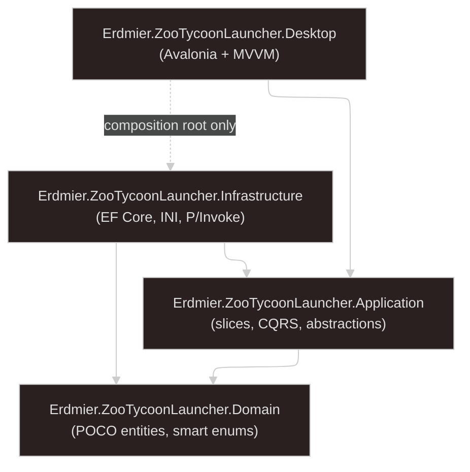
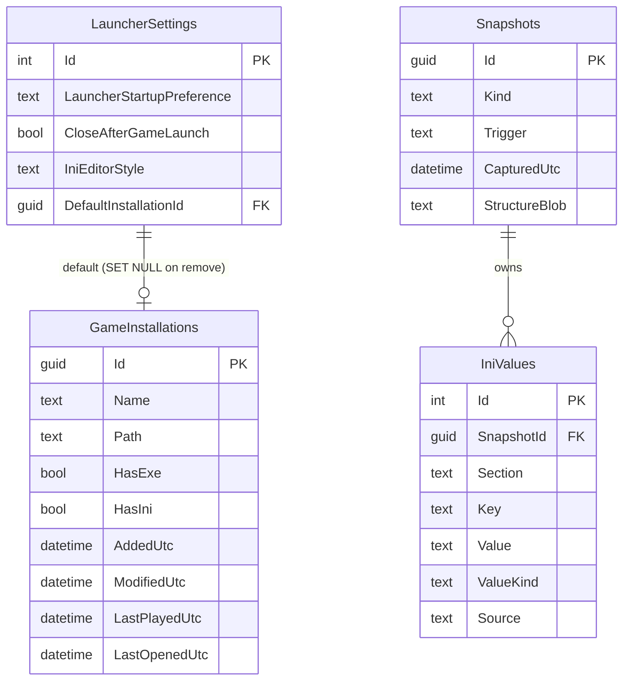
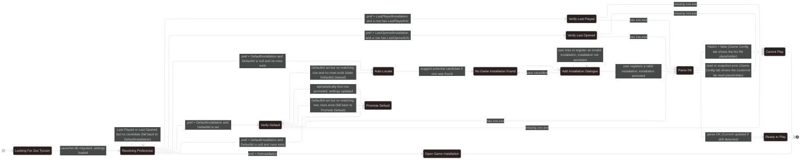
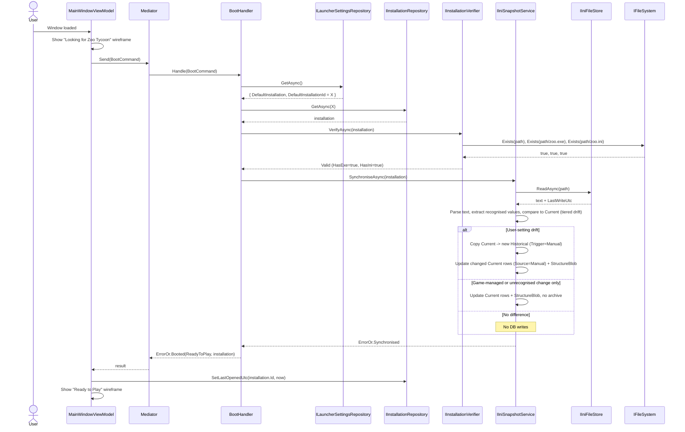

# Zoo Tycoon Launcher — Software Design Document

> A native Windows desktop launcher for **Zoo Tycoon (2001)**: multi-installation discovery and management, exhaustive INI configuration with full historical versioning, and  
> one-click launch. Avalonia 11 + Classic.Avalonia, .NET 10.
  
---  

## Document control

| Field                    | Value                             |
|--------------------------|-----------------------------------|
| **Project**              | Zoo Tycoon Launcher               |
| **Document**             | Software Design Document (SDD)    |
| **Version**              | 1.16                              |
| **Status**               | Draft for implementation          |
| **Author**               | Justinian                         |
| **Last updated**         | 22 October 2026                   |
| **Language conventions** | Standard Southern British English |

### Revision history

| Version | Date              | Author    | Notes                                                                                                                                                                                                                                                                                                                                                                                                                                                                                                                                                                                                                                                                                                                                                                                                                                                                                                                                                                                                                                                                                                                                                                                                                                                                                                                                                                                                                                                                                                                                                                                                                                                                                                                                                                                                                                                                                                                                                                                                                                                                                                                                                                                                                                                                                                                                                                                                                                                                                                                                                                                                                                                                                                                                                                                            |
|---------|-------------------|-----------|--------------------------------------------------------------------------------------------------------------------------------------------------------------------------------------------------------------------------------------------------------------------------------------------------------------------------------------------------------------------------------------------------------------------------------------------------------------------------------------------------------------------------------------------------------------------------------------------------------------------------------------------------------------------------------------------------------------------------------------------------------------------------------------------------------------------------------------------------------------------------------------------------------------------------------------------------------------------------------------------------------------------------------------------------------------------------------------------------------------------------------------------------------------------------------------------------------------------------------------------------------------------------------------------------------------------------------------------------------------------------------------------------------------------------------------------------------------------------------------------------------------------------------------------------------------------------------------------------------------------------------------------------------------------------------------------------------------------------------------------------------------------------------------------------------------------------------------------------------------------------------------------------------------------------------------------------------------------------------------------------------------------------------------------------------------------------------------------------------------------------------------------------------------------------------------------------------------------------------------------------------------------------------------------------------------------------------------------------------------------------------------------------------------------------------------------------------------------------------------------------------------------------------------------------------------------------------------------------------------------------------------------------------------------------------------------------------------------------------------------------------------------------------------------------|
| 0.1     | 26 May 2026       | Justinian | Initial full draft, developed from the rewrite brief and confirmed brainstorming outcomes (architecture, persistence, startup, installation, INI tab).                                                                                                                                                                                                                                                                                                                                                                                                                                                                                                                                                                                                                                                                                                                                                                                                                                                                                                                                                                                                                                                                                                                                                                                                                                                                                                                                                                                                                                                                                                                                                                                                                                                                                                                                                                                                                                                                                                                                                                                                                                                                                                                                                                                                                                                                                                                                                                                                                                                                                                                                                                                                                                           |
| 1.0     | 26 May 2026       | Justinian | Baselined for implementation; status changed from Draft to Draft for implementation pending Phase 0 research spikes (§7.8, §7.9).                                                                                                                                                                                                                                                                                                                                                                                                                                                                                                                                                                                                                                                                                                                                                                                                                                                                                                                                                                                                                                                                                                                                                                                                                                                                                                                                                                                                                                                                                                                                                                                                                                                                                                                                                                                                                                                                                                                                                                                                                                                                                                                                                                                                                                                                                                                                                                                                                                                                                                                                                                                                                                                                |
| 1.1     | 26 May 2026       | Justinian | Added view-composition convention: each main-window state, each tab, and each INI section is its own UserControl + ViewModel pair (§9.2). Architecture test in §11.4 enforces the every-VM-has-a-View rule.                                                                                                                                                                                                                                                                                                                                                                                                                                                                                                                                                                                                                                                                                                                                                                                                                                                                                                                                                                                                                                                                                                                                                                                                                                                                                                                                                                                                                                                                                                                                                                                                                                                                                                                                                                                                                                                                                                                                                                                                                                                                                                                                                                                                                                                                                                                                                                                                                                                                                                                                                                                      |
| 1.2     | 27 May 2026       | Justinian | Hi-fi prototype consumed and merged into §9 — File/Help menus only, no min/max chrome, 720 px main window, button-label cleanup (no ellipses on buttons); Installation Manager rename; new INI Config tab layout (sectioned list on the left, scrolling form on the right, hover + status help affordance, no dedicated help groupbox); Add/Edit Installation dialogue gains a folder input with `Browse…` (no picker-first flow); Restore Previous INI dialogue gains an inline diff (key · current · snapshot) and drops the Note column; Cannot Play Display section matches Ready's layout (muted, with a one-liner); Last played surfaced even in Cannot Play; [ai] section carries a stock-limit blurb; INI Config tab disabled in Looking / NoInstall / OpenPicker states; Settings dialogue picks up a `Theme` choice (System / Light / Dark) and a corresponding entity field. Old `docs/wireframes/` JPGs removed; replaced by a single screen-recording GIF at `Docs/UserInterfaceDesign/ZooTycoonLauncherHiFiUIPrototype.gif`. The live hi-fi prototype in Claude Design remains the authoritative visual reference; the GIF is a quick in-repo glance.                                                                                                                                                                                                                                                                                                                                                                                                                                                                                                                                                                                                                                                                                                                                                                                                                                                                                                                                                                                                                                                                                                                                                                                                                                                                                                                                                                                                                                                                                                                                                                                                                            |
| 1.3     | 5 June 2026       | Justinian | Startup state machine overhauled (§7.1.1): `AutoLocate` now always settles to `NoGameInstallationFound` (carrying the discovered candidate as a suggestion) rather than skipping straight to the Add dialogue; `NoGameInstallationFound → AddInstallationDialogue → ParseIni` is the new add-from-boot path. `HasIni = false` resolves to **Cannot Play** (not Ready to Play) — no INI, no launch. `§9` made leaner: dialogue/panel pixel widths, column percentages, opacity values, and other dev-time style decisions stripped in favour of brief layout sketches that defer to the live hi-fi prototype. Application services formalised: `IDialogService` covers `ShowAddInstallationAsync(prefilledPath)` / `PickFolderAsync(startPath)` / `ShowLaunchError(message)`; new `IApplicationLifecycle` carries `CloseAfterGameLaunch` shutdown intent. `LaunchGameResult` returns one of three `LaunchGameOutcome` branches: `Started`, `Drifted` (re-verify failed; re-enter boot), `StartFailed` (OS rejected the start). Main window width is 480 px while booting and 720 px once booted; `ScenariosTabViewModel` removed (Scenarios is a section of the INI Config tab, never a sibling tab).                                                                                                                                                                                                                                                                                                                                                                                                                                                                                                                                                                                                                                                                                                                                                                                                                                                                                                                                                                                                                                                                                                                                                                                                                                                                                                                                                                                                                                                                                                                                                                                             |
| 1.4     | 10 July 2026      | Justinian | Startup default-resolution hardened (§7.1.1, §7.1.2): a *stale* `DefaultInstallationId` (set but with no matching `GameInstallation` row) now falls through the same Promote Default → Auto Locate path as a null id instead of dead-ending on `NoGameInstallationFound`; when nothing can be promoted the stale pointer is cleared back to null so it no longer dangles (complements the defensive delete cascade in §7.2.4). `InstallationValidity` gains `HasExe` / `HasIni` flags so the presentation reads the `(HasExe, HasIni)` pair off the smart enum rather than re-deriving it. Cannot Play General tab reworked (§9.1, §9.2.1): per-sub-state Status messaging (missing EXE / INI / both), the `Launch Game` slot swaps to an `Open Installation Manager…` button (no separate disabled button or duplicated Fix control), and the Display and new Your System group boxes stay un-muted with a state-specific footnote each.                                                                                                                                                                                                                                                                                                                                                                                                                                                                                                                                                                                                                                                                                                                                                                                                                                                                                                                                                                                                                                                                                                                                                                                                                                                                                                                                                                                                                                                                                                                                                                                                                                                                                                                                                                                                                                                        |
| 1.5     | 23 September 2026 | Justinian | Amended §7.2.2 (Installation Manager dialogue) to match §9.4 and the implementation: the first sentence now describes the actual three-column, headered `DataGrid` (`Name`, `Path`, `Status`) instead of the old two-unheadered-column description, and the Sort-order bullet cites `InstallationGridRowModel` and the ` · default` suffix instead of the retired `InstallationRow` / `IComparer<InstallationRow>`. Rewrote §7.2.7 (retitled `Picker (Open Game Installation) — pointed boot`) to match §9.6 and the implementation: the picker is the `OpenGameInstallation` main-window state, not a modal dialogue, and selecting a row + `Open` (or double-clicking) dispatches `BootCommand` with the chosen installation's id as a *pointed boot* that re-enters the pipeline at `Verify`, bypasses the startup preference, and never writes `DefaultInstallationId`, falling back to normal resolution if the id no longer exists. A same-revision follow-up pass then finished aligning the SDD with the picker's main-window-state nature: §7.2.7's closing sentence now states plainly that no unsaved-changes guard is needed on the picker, since it only appears when no installation is active; the §7.3.2 pending-changes bullet now attributes the `IPendingChangesGuard` path to switching installations from the Installation Manager instead of the picker; the §7.2.2 subscribers list now reads "the picker's grid (the `OpenGameInstallation` state)" instead of "the picker dialogue's grid"; and the §9.2 Dialogues folder list no longer lists `Picker` (already covered by the `OpenGameInstallationView.axaml` entry under States/). All amendments in this revision were drafted by Claude during the installation-grid-control implementation run.                                                                                                                                                                                                                                                                                                                                                                                                                                                                                                                                                                                                                                                                                                                                                                                                                                                                                                                                                                                                                  |
| 1.6     | 24 September 2026 | Justinian | §7.2.1: with no installations registered, the Add Installation dialogue pre-fills the Name input with `Main` (an editable value, previously described as a placeholder); the Default checkbox stays ticked and read-only; the "Placeholder rules" heading is renamed "Default-name rules" to match. §7.2.3 / §9.5: Edit Installation shares the Add form rather than duplicating it — the folder is read-only with no `Browse…` button (relocation is Fix's job, §7.2.5), and the Default checkbox is ticked and read-only when the installation is already the default. Drafted by Claude during the installation-management-dialogues slice.                                                                                                                                                                                                                                                                                                                                                                                                                                                                                                                                                                                                                                                                                                                                                                                                                                                                                                                                                                                                                                                                                                                                                                                                                                                                                                                                                                                                                                                                                                                                                                                                                                                                                                                                                                                                                                                                                                                                                                                                                                                                                                                                                   |
| 1.7     | 24 September 2026 | Justinian | INI Config core slice (spec `milestone-8-ini-config-core-design.md`). §5.3 replaces the typed `ZooIniModel` with a key registry (`IniKeyId`, `IniKeyRole`, `IniKeySpec`, `ZooIniDefaults`); raw values are stored as found and the editor falls back to defaults at display time. Drift is tiered (§7.1.3, §7.7, glossary): game-managed and unrecognised changes are adopted silently; only user-setting changes archive `Current`. Save (§7.3.2, §8.2) re-reads `zoo.ini` and merges edits onto the on-disk text after reconciling external drift in the same transaction. §8.1 records Latin-1 byte fidelity, per-line line endings, and no inline-comment parsing. §4.2 swaps `IIniReader` / `IIniWriter` for `IIniFileStore` / `IIniSnapshotRepository`. §9.2.1–§9.2.2 use one generic section view pair under `IniConfig/`. §7.4 / §7.5 defer to §9.3.1 and describe the interim placeholder. §9.3.2 sources help from the Desktop catalogue. §6.3 notes the `AddSnapshotIndexes` migration and defers `InstallationMetadata`. §11 adds `Desktop.Tests.Unit`; §14.5 adds the VirtualStore and edits-while-running risks. A same-revision follow-up pass then closed out the final review's documentation gaps: the retired `IniPresent` / `NoIniPresent` / `CorruptedIni` state names are gone from §3.1, §7.1, §7.4–§7.6, and §13, replaced by the editor / placeholder wording §9.3.1 already used; §9.3.1 and §9.3.2 pick up the reload-while-dirty rule, the corrected could-not-be-read trigger, the local-time footer, and a de-nested parenthetical; §9.2.2's Dialogues line names the Save Changes prompt and the error message dialogue; §7.3's integer row cites its actual control width; §7.3.2 and §7.10 gain the close-after-launch pending-edit exception, the `Drifted` guard, a single unsaved-changes prompt at a time, and a second Save that awaits the in-flight one instead of duplicating it; §7.2.2 documents the Installation Manager's pointed-boot reboot and its own guard; §7.7/§8.2 cover a no-effective-edits Save and the two post-reconcile/post-write store-failure rules; §4.2 lists `IIniSnapshotTransaction`; and §11 corrects its test-project count and relocates two misplaced `Desktop.Tests.Unit` bullets. Drafted by Claude during the INI Config core final review. A second same-revision pass adds §13.5, the deferred work register: every open follow-up from PRs #4–#6, the review findings parked as minor, the code `TODO`s and the maintainer's notes, each under a stable `DW` id with its origin, so none of them lives only in a pull request. §14.5 row 9 then records the confirmed read-only-installation-folder risk: the MVP will detect it and recommend a reinstall (DW-12), and V2.0.0 will try a VirtualStore copy (DW-36). |
| 1.8     | 20 October 2026   | Justinian | The Ref build has been removed from the repository (commit `8e0532b`). §1.5 now records the removal and reads later "Ref build" mentions as design rationale; §4.2 drops the `References/` folder and the separate Ref solution file, and its tree gains the existing `Desktop.Tests.Unit` project; §4.7 and the glossary are reworded to match.                                                                                                                                                                                                                                                                                                                                                                                                                                                                                                                                                                                                                                                                                                                                                                                                                                                                                                                                                                                                                                                                                                                                                                                                                                                                                                                                                                                                                                                                                                                                                                                                                                                                                                                                                                                                                                                                                                                                                                                                                                                                                                                                                                                                                                                                                                                                                                                                                                                 |
| 1.9     | 20 October 2026   | Justinian | The blanket no-ellipses-on-buttons rule is retired in favour of the Win9x guideline: a button or menu item that needs more input before it can complete carries an ellipsis. §9.3 and §9.5 drop their no-ellipsis sentences. §13.5.1 adds DW-37 (rename Settings to Options) and DW-38 (watch `zoo.ini` for changes in real time). Milestone 9 (spec `milestone-9-restore-previous-ini-design.md`): §7.3.3 is retitled *Restore previous button* and §7.6 *Restore Previous INI dialogue* (restore steps restated over the §8.2 ordering: user settings only, effective values, absent keys untouched, shared Save pipeline, `HistoricalCount`); §9.3 footer becomes `Restore previous…` / `Restore defaults` / `Save` / `Reset` (`Revert` and `Undo` retired); §9.4, §9.5 and §9.6 take the Win9x ellipsis labels (`Add…`, `Edit…`, `Fix…`, `Locate…`, `Manage…`) and Installation Info counts history entries; §9.7 shows `Captured` in local time with `Original` last, newest selected on open, the kept-keys note and user settings only; §13.5.1 deletes DW-02, DW-03 and DW-08, which this milestone delivers. |
| 1.10    | 20 October 2026   | Justinian | Milestone 9.1 (Restore Previous INI follow-ups). §13.5.1 adds DW-39: the dark-theme work left over from milestone 9 belongs to the Settings + theming slice's sweep of every view, not to piecemeal INI changes. The row's pointer sets the field's `IsHovered` and focus sets `IsFocused` (§9.3.2); the INI tab, editor and Restore dialogue log failures; the Restore dialogue loads its history before opening. Deletes DW-17, DW-18 and DW-27 from §13.5. A Save also deletes orphan temp files before reading (§7.7, §8.2); conventions §3.3 follows §9.3.2. |
| 1.11    | 21 October 2026   | Justinian | Milestone 9.2 (INI display polish). §9.3 describes the dollar display of the four `[UI]` cash rows and the read-only `lang` / `sublang` rows behind the curated picker; §9.7 describes diff cells that read as the editor shows them (labels, `true` / `false`, dollars) and inert history headers. Every `ClassicWindow` title starts with two spaces (conventions §4.1). |
| 1.12    | 21 October 2026   | Justinian | Milestone 10 (INI recovery and read-only detection; spec `milestone-10-ini-recovery-and-read-only-detection-design.md`). §7.4 describes the two recovery actions as built (`CreateDefaultIniCommand`, `LocateIniCommand`: create-only write, first import or `Manual` archive of a surviving `Current`, `Ini.AlreadyExists` / `Ini.NotAnIni` / `Ini.ReadOnly`); §7.2.5, §9.3.1 and §9.5 give the Fix INI group and the No INI box their `Create` / `Locate…` buttons and add the INI tab's read-only strip; §7.1.2 Verify runs the write probe (`Writable`, `FolderReadOnly`, `FileReadOnly`, `Unknown`); §9.1 Cannot Play points at the INI Config tab; §14.5 row 9's MVP mitigation is implemented. §13.5.1 deletes DW-01 and DW-12, which this milestone delivers, and adds DW-40 (Copy From Another Installation). |
| 1.13    | 22 October 2026   | Justinian | Milestone 11 (Options dialogue and colour cleanup; spec `milestone-11-options-and-colour-cleanup-design.md`). Dark mode and themes are scrapped: §5.1 / §5.2 / §6.2 drop `LauncherSettings.Theme`, the `LauncherTheme` enum and its column, and §5.2 drops `InstallationValidity.ColourToken` (a colour is presentation, not domain); §9.11 is reduced to a removal note. §9.8 describes the Options dialogue as built (Startup and Game launch only) and §9.10 renames the File menu item to `O<u>p</u>tions…`; §9.12 and §13.2 follow. The launcher's colours are defined once in `Styles/Colours.axaml` and guarded by an architecture test (conventions §1). §13.5 deletes DW-20, DW-37 and DW-39, which this milestone delivers. |
| 1.14    | 22 October 2026   | Justinian | Milestone 11.1 (style tokens and follow-ups; spec `milestone-11.1-style-tokens-and-follow-ups-design.md`). Typography, spacing and the repeated control sizes join colours as named tokens: `Styles/Typography.axaml`, `Styles/Spacing.axaml` and `Styles/Controls.axaml` sit beside `Colours.axaml`, with `SpaceExtension` building margins and paddings from token names, an architecture test per group, a `TokenReferencesTests` check that every token and resource reference resolves, and an `AvaloniaProperties_ArePublic` check (§9.2.2, §9.11, §11.5). Spacing snaps onto the Windows 9x guideline values (dialog units converted to pixels), with measured icon-gap tokens and a group-box padding derived from the tokens. Faded text uses one method, the muted grey (`MutedText`); icons draw pixel-crisp; the Options dialogue refuses Cancel and close while a save is in flight, and the Restore dialogue guards its Cancel; the colour test covers every `*Brush` attribute, element content and split setters; the persistence test helpers share one `ProjectPaths`. §9 and conventions.md describe the tokens, and DW-24 keeps only its second half (reusable stack and dock panel controls). Follow-ups: only keyboard focus keeps an INI field focused (a pointer-focused field releases once its value is set; a click elsewhere or Esc clears it); `ForegroundMuted` darkens to `#666666`; the installation grid's headers are inert (`InertHeaders`) and its columns no longer resize; and the colour registry in conventions.md is trimmed to the 11 keys `Colours.axaml` defines, checked by `ColourRegistryTests`. |
| 1.15    | 22 October 2026   | Justinian | Headless view-load test. §11.4 adds `ViewLoadTests`, which loads every view under the real application resources with its designer view model and fails on a load-time exception or an Avalonia warning; §11.5 notes that a missing `{StaticResource}` on a control property stays silent at run time, so `TokenReferencesTests` remains its guard; §11.7 lists `Avalonia.Headless.XUnit`. §11.4 also adds `IniFieldFocusTests`, which drives the real INI editor with keyboard and pointer input; they found that `IniFieldFocusRelease.IsWithin` missed a drop-down's items when the pop-up is an overlay, and §9.3.2 now says it walks logical parents first. |
| 1.16    | 22 October 2026   | Justinian | Milestone 12 (INI editor display style; spec `milestone-12-ini-editor-display-style-design.md`). The INI Config editor gains two display styles chosen in Options: a Friendly style (the default) that groups settings into eight pages by purpose with plain labels, meaning-based values and volume sliders, and an INI style that shows `zoo.ini` literally (the inverted `noMenuMusic` included). §5.1 / §5.2 / §5.5 / §6.2 add `LauncherSettings.IniEditorStyle` and the `IniEditorStyle` SmartEnum; §9.3 gains §9.3.3 *Display styles*; §9.7 makes the diff follow the style; §9.8 adds the *INI editor* group box, which applies on `OK`; §13.2 names both styles. Follow-ups: a **View** menu (*Config layout* ▸ *Friendly style* / *INI style*) switches the style from the main window (§9.10, §9.3.3); the Friendly cash keys describe the new-zoo starting-cash picker; the language codes sit on their own line; the Restore dialogue's Friendly key column uses the system face (§9.7). |
| 1.17    | 23 October 2026   | Justinian | Milestone 13 (Game Config tab rename). The INI Config tab is renamed Game Config for players throughout (§2.2, §3.1, §5.1, §7.1, §7.2, §7.3–§7.5, §9, §9.1, §9.3, §9.3.1, §9.3.3, §9.8 Options copy, whose group box becomes *Config editor*, §9.12, §11.4, §13.2, §13.5.1, §14.5, §15), and its documented access key moves to Alt-C. §9.3 records why the code identifiers keep `IniConfig`. |

  
---  

## Table of contents

1. [Introduction](#1-introduction)
2. [Product overview](#2-product-overview)
3. [Goals and non-goals](#3-goals-and-non-goals)
4. [Architecture](#4-architecture)
5. [Domain model](#5-domain-model)
6. [Persistence design](#6-persistence-design)
7. [Functional design](#7-functional-design)
8. [Algorithms and defaults](#8-algorithms-and-defaults)
9. [User interface](#9-user-interface)
10. [Cross-cutting concerns](#10-cross-cutting-concerns)
11. [Testing strategy](#11-testing-strategy)
12. [Cross-platform readiness](#12-cross-platform-readiness)
13. [Delivery roadmap](#13-delivery-roadmap)
14. [Risks, assumptions, and open questions](#14-risks-assumptions-and-open-questions)
15. [Glossary](#15-glossary)
16. [References](#16-references)

---  

## 1. Introduction

### 1.1 Purpose of this document

This document specifies the design of the **Zoo Tycoon Launcher**, a native Windows desktop application that discovers, configures, and launches **Zoo Tycoon (2001)** game  
installations. It is intended to be an implementation-ready reference covering architecture, the domain and data models, the principal workflows, the supporting algorithms, the  
user interface, and the phased delivery plan.

### 1.2 The name

*Zoo Tycoon Launcher.* The name is descriptive rather than evocative; the application is a launcher in the established game-launcher tradition (think GoG Galaxy, Steam, MO2) but  
narrowly focused on the 2001 game and its INI-driven configuration surface.

### 1.3 Scope

This document covers the **Minimum Viable Product (MVP)** in full detail and sketches the post-MVP roadmap at lower fidelity. The MVP is a **Windows-only** desktop application;  
cross-platform support is **not** a goal at any stage because Zoo Tycoon (2001) itself runs only on Windows ([Section 12](#12-cross-platform-readiness)). The MVP delivers:

- Multi-installation discovery and management.
- Exhaustive INI configuration per installation with full historical versioning persisted in SQLite.
- Verified Scenarios management (post-research; [Section 7.8](#78-scenarios-research-workflow)).
- Display-mode enumeration and ZT1-compatible resolution filtering (post-research; [Section 7.9](#79-screen-modes-calculation)).

Saves management and mods management are reserved for V2 and sketched in [Section 13](#13-delivery-roadmap).

### 1.4 Intended audience

The primary audience is the single maintainer. The document is also written so a future contributor (or an AI coding assistant working from CLAUDE.md and this spec) can
understand  
the rationale behind the principal decisions without prior context.

### 1.5 Relationship to the prior reference build

A working, single-project prototype existed at the start of this rewrite. That build (the *Ref* assembly, `Erdmier.ZooTycoonLauncherRef`) was kept in the repository under
`References/` as read-only inspiration while the early slices were built, and was removed on 20 October 2026 (commit `8e0532b`; its parent still holds the files). Nothing in
the new launcher is copy-pasted from it. The Ref build informed the design where its choices proved sound (the line-preserving INI tokeniser, the `IFileSystem` /
`IRegistryReader` abstractions, the `ZooIniDefaults` registry pattern, the `ViewLocator` convention); each was reimplemented from scratch against the new layered architecture.
Later sections still name the Ref build where it explains a design decision; those mentions are rationale, not pointers to files in the repository.
  
---  

## 2. Product overview

### 2.1 Problem statement

Zoo Tycoon (2001) is a beloved classic with two long-standing pain points for modern players:

1. **INI configuration is opaque.** The game reads dozens of behaviour, AI, debug, and rendering settings from `zoo.ini`, but offers no in-game UI to edit most of them. Players  
   resort to hand-editing the file (risking syntax errors), undoing changes (which the game does not support), or running brittle third-party tools that mutate files without  
   preserving structure or providing history.
2. **Installations multiply.** Many players keep more than one ZT1 installation — one stock, one with the Complete Collection content, one with community mod packs — and
   switching  
   between them, knowing which is which, and applying installation-specific settings is a manual file-shuffling exercise.

The launcher solves both: it persists the strongly typed INI state in SQLite with full history, edits the file atomically with crash-recoverable ordering, and treats multiple  
installations as a first-class concept with a dedicated management surface.

### 2.2 Central concepts

**Installation.** A discrete `Microsoft Games\Zoo Tycoon\`-shaped directory containing at minimum `zoo.exe` (the launchable game) and ideally `zoo.ini` (the configuration file).  
The launcher tracks any number of installations by `Guid`, each with its own database (see [Section 6](#6-persistence-design)).

**Default installation.** Exactly one installation, when there is at least one, is the **default**. It is the installation the launcher opens on start when  
`LauncherStartupPreference = DefaultInstallation`, the row whose name is rendered **bold** in the Installation Manager dialogue, and the implicit "if I had to pick one, this one"  
target.

**INI snapshot.** Point-in-time materialisation of every recognised `zoo.ini` setting plus the original file's structure (comments, blank lines, key ordering, unknown keys).
The  
launcher tracks three kinds: `Original` (captured once when the installation was first added), `Current` (the value the launcher believes is on disk *right now*), and  
`Historical` (every prior `Current` state, retained for restore).

**Drift.** A difference between the `Current` snapshot's values and the actual `zoo.ini` on disk. Drift is tiered: a changed user setting archives `Current` to `Historical`  
(`Trigger = Manual`) before the new values are adopted; game-managed and unrecognised changes are adopted silently, with no archive. Detection runs whenever the installation  
opens (at boot, or when switching installations), when the Game Config tab is activated, and when saving.

**Scenarios.** The `[scenario]` section of `zoo.ini` is a list of two-letter keys whose values control which scenarios are flagged complete or locked. The full mapping (key →  
scenario, value → state) is unverified at the time of writing and is a Phase 0 research deliverable ([Section 7.8](#78-scenarios-research-workflow)).

**Display modes (screen modes).** Windows reports a list of supported `(width, height, colour depth, refresh rate, orientation)` tuples per attached display device via  
`EnumDisplaySettingsEx`. ZT1 can only drive a subset — colour-depth-, resolution-, and refresh-rate-bound. The launcher's Home/General tab surfaces both counts; the filter  
predicate is a Phase 0 deliverable ([Section 7.9](#79-screen-modes-calculation)).

### 2.3 Primary user and assumptions

- A single user operating on a single Windows machine at a time.
- The user is comfortable installing a desktop application and granting it access to local folders, but is **not** expected to use a registry editor, a hex editor, or a  
  command-line tool to fix ZT1 configuration.
- The user may have one or many ZT1 installations and may add or remove them at any time.
- ZT1 itself runs unmodified — the launcher never patches the executable, never injects code, and never replaces game files outside `zoo.ini`.

### 2.4 Windows-only is deliberate, not provisional

The Zoo Tycoon Launcher is **permanently Windows-only**. The game binary is  
a 32-bit Windows executable from 2001; Avalonia's cross-platform UI capability is incidental, retained only because Classic.Avalonia (the chosen theme library) builds on Avalonia

> See [Section 12](#12-cross-platform-readiness).

---  

## 3. Goals and non-goals

### 3.1 MVP goals

1. **Discover installations** automatically (registry, hard-coded vendor paths, persisted last-known directory) and let the user add more by folder selection.
2. **Manage installations** through a dedicated dialogue: add, edit (rename, change default), delete, fix invalid, view info.
3. **Persist launcher state** to SQLite under `%LOCALAPPDATA%\ZooTycoonLauncher\Data\` with code-first EF Core migrations.
4. **Persist per-installation INI state** to a per-installation SQLite database, modelled as EAV snapshots with `Original`, `Current`, and `Historical` tables.
5. **Parse `zoo.ini`** into an `IniDocument` and extract every recognised key's raw value via `ZooIniDefaults`, preserving comments, blank lines, key ordering, and  
   unrecognised keys for byte-fidelity round-trip writes.
6. **Edit every recognised INI setting** through a dedicated Game Config tab, grouped by section, with strongly typed inputs (checkbox, NumericUpDown, TextBox, ComboBox).
7. **Atomic INI writes** with crash-recoverable ordering: archive `Current` → write the file → replace `Current`, in a single EF transaction; the file write operation itself is a
   temp-file +  
   `Move(overwrite: true)`.
8. **Manual-edit detection.** When `zoo.ini` is mutated outside the launcher, the launcher detects the drift (on next open, on Game Config tab activation, and on save) and applies 
   the tiered rule: a changed user setting archives the prior `Current` to `Historical` before adopting the file's values; game-managed and unrecognised changes are adopted  
   silently, with no archive.
9. **Historical restore.** The `Restore previous…` button on the Game Config tab opens a dialogue listing every prior version (timestamped) and lets the user restore any of them.
10. **Game Config tab** that hosts either the editor or a placeholder — Loading, No INI, or could-not-be-read — based on the installation's state, with `Create` and `Locate`
    recovery actions on the No INI placeholder (the could-not-be-read placeholder has none yet). A missing `zoo.ini` resolves the main window to **Cannot Play** with the
    Launch Game button disabled — the launcher will not start the game without a parsed INI.
11. **Scenarios section** within the Game Config tab with verified key→scenario→tier mapping (Phase 0 research) rendered as a checkbox grid.
12. **Screen modes panel** on the General tab showing the total available display modes and the ZT1-compatible subset, with a research-driven filter predicate (Phase 0).
13. **Launch Game** kicks the game off as a child process with the correct working directory and respects the `CloseAfterGameLaunch` setting.

### 3.2 Non-goals (deferred or excluded permanently)

- **Cross-platform support.** Permanently excluded ([Section 2.4](#24-windows-only-is-deliberate-not-provisional), [Section 12](#12-cross-platform-readiness)).
- **Patching `zoo.exe` or any game binary.** Permanently excluded.
- **Saves management.** Deferred to V2 ([Section 13](#13-delivery-roadmap)).
- **Mods / custom-content manager.** Deferred to V2.
- **Recommended-resolution heuristic.** A DPI-aware "this resolution looks best on your panel" recommendation. Deferred to V3 / Quality of Life.
- **Historical-snapshot retention cap.** MVP retains all historical snapshots; a configurable cap is V3.
- **Localisation beyond British English.** The launcher targets British English throughout; broader localisation is V3.

---  

## 4. Architecture

### 4.1 Architectural style

The launcher adheres to the following principles:

- **Clean Architecture** for dependency direction: inner layers (Domain, Application) have no dependency on outer layers (Infrastructure, Desktop).
- **Vertical Slice Architecture (VSA)** for application code: each user-facing operation is a self-contained slice (request, handler, validator, response) rather than spread
  across  
  horizontal service/repository layers.
- **CQRS** via source-generated mediation (see [Section 4.4](#44-mediation-and-cqrs)).
- **POCO domain entities** — Domain-Driven Design as a methodology is *not* used; entities are plain CLR objects with `SmartEnum` providing richer enumerations where helpful.

### 4.2 Solution structure

```text  
Erdmier.ZooTycoonLauncher.slnx  
├── Source/  
│   ├── Erdmier.ZooTycoonLauncher.Domain/         # POCO entities, smart enums, INI key registry, scenario key registry  
│   ├── Erdmier.ZooTycoonLauncher.Application/    # VSA slices: commands, queries, handlers, validators, abstractions  
│   ├── Erdmier.ZooTycoonLauncher.Infrastructure/ # EF Core + SQLite, INI parser, Win32 P/Invoke, Serilog  
│   └── Erdmier.ZooTycoonLauncher.Desktop/        # Avalonia views (AXAML), view models, DI composition root  
├── Tests/  
│   ├── Erdmier.ZooTycoonLauncher.Domain.Tests.Unit/  
│   ├── Erdmier.ZooTycoonLauncher.Application.Tests.Unit/  
│   ├── Erdmier.ZooTycoonLauncher.Infrastructure.Tests.Integration/  
│   ├── Erdmier.ZooTycoonLauncher.Desktop.Tests.Unit/  
│   └── Erdmier.ZooTycoonLauncher.Tests.Architecture/  
```

The root namespace for every project is `Erdmier.ZooTycoonLauncher`. Production projects live under `Source/`; test projects under `Tests/`. Test projects follow
`<Project/Assembly Name>.Tests.<Category>` where the category is `Unit`, `Integration`, `Architecture` (e.g. `Erdmier.ZooTycoonLauncher.Domain.Tests.Unit`); solution-spanning
architecture tests attach to the root name (`Erdmier.ZooTycoonLauncher.Tests.Architecture`).

Dependency direction: `Desktop → Application → Domain`, and `Infrastructure → Application/Domain`, with `Desktop` composing `Infrastructure` only at the composition root. The  
Application layer defines interfaces (e.g. `IInstallationRepository`, `IIniSnapshotRepository`, `IIniSnapshotTransaction`, `ILauncherSettingsRepository`, `IInstallationVerifier`,  
`IInstallationLocator`, `IIniFileStore`, `IIniSnapshotService`, `IScreenModeEnumerator`, `IZooTycoonResolutionFilter`, `IFileSystem`, `IRegistryReader`, `IAppStorageLocations`,  
`IProcessLauncher`, `IApplicationLifecycle`); Infrastructure provides the implementations. Desktop-specific chrome surfaces (folder pickers, modal dialogues, launch-error  
windows) are owned by `IDialogService` in the Desktop layer rather than Application, since they consume Avalonia visuals directly.



### 4.3 Presentation: Avalonia 11 + `Classic.Avalonia` + MVVM

- **UI framework:** Avalonia 11.3 (current 11.x line). Avalonia 12 is not adopted because `Classic.Avalonia` — the theme library that makes the launcher look like a Windows 95/98  
  application — has a hard dependency on Avalonia 11. The maintainer prefers the Windows 9x aesthetic as a default (a deliberate design preference, not a fallback).
- **Theme:** `Classic.Avalonia.Theme` (+ `.DataGrid`, `.Dock` add-ons). This styles every control to look and feel like a Windows 95/98 application, matching the ZT1 era.
- **MVVM:** `CommunityToolkit.Mvvm` for `ObservableObject`, source-generated `[ObservableProperty]` on `partial` properties, `[RelayCommand]` on private async methods, and
  `IMessenger` for cross-view-model notifications. Used **in conjunction with** Avalonia's compiled bindings — Avalonia handles binding/styling/the compiled-binding pipeline, the
  toolkit reduces view-model boilerplate.
- **View resolution:** the `ViewLocator` registered as an `Application.DataTemplates` entry maps each `*ViewModel` to its `*View` by string-replacing `"ViewModel"` → `"View"` and  
  `Activator.CreateInstance`-ing it. Don't rename one half without the other.
- **Compiled bindings:** `AvaloniaUseCompiledBindingsByDefault` is on; every XAML file declares `x:DataType` for bindings to compile.
- **View composition:** the Desktop layer composes views the way Blazor / React / Angular compose components — `MainWindow.axaml` hosts only application chrome, with each  
  main-window state, each tab, and each INI section landing as its own `UserControl` + `ViewModel` pair. Full convention in [Section 9.2](#92-view-composition).

### 4.4 Mediation and CQRS

CQRS is implemented with **Martin Othamar's `Mediator`** library (source-generated, allocation-light). Each vertical slice defines an `IRequest` / `IRequestHandler` pair;  
cross-cutting behaviour (validation, logging) is layered with pipeline behaviours. Handlers return `ErrorOr<T>` — expected failure paths (validation errors, missing files, parse  
errors) are values, not exceptions.

### 4.5 Cross-cutting libraries (carried over)

- **ErrorOr** (Amichai Mantinband) — discriminated result type for handler return values.
- **FluentValidation** — request validation, executed in a mediator pipeline behaviour.
- **Ardalis.SmartEnum** — richer enumerations.
- **Serilog** — structured logging with a **file-only** sink under `%LOCALAPPDATA%\ZooTycoonLauncher\Logs\`.
- **Microsoft.Extensions.DependencyInjection** — DI container, composed in `App.OnFrameworkInitializationCompleted` and exposed as `App.Services`.
- **System.IO.Abstractions** — `IFileSystem` for testable file-system access.
- **JetBrains.Annotations** — `[UsedImplicitly]` on designer/runtime-only types to keep ReSharper/Rider quiet.

### 4.6 Dependencies and licensing

| Dependency                                  | Purpose                         | Licence              | Notes                                              |  
|---------------------------------------------|---------------------------------|----------------------|----------------------------------------------------|  
| .NET 10                                     | Target framework (`net10.0`)    | MIT                  | —                                                  |  
| Avalonia 11.3.x                             | UI framework                    | MIT                  | Pinned to 11.x for Classic.Avalonia compatibility. |  
| Classic.Avalonia.Theme (+ DataGrid, + Dock) | Windows 9x theme                | MIT (confirm)        | Hard dependency on Avalonia 11.                    |  
| Avalonia.Fonts.Inter                        | Bundled fallback font           | MIT                  | —                                                  |  
| CommunityToolkit.Mvvm                       | MVVM helpers                    | MIT                  | Source generators.                                 |  
| `Mediator` (martinothamar)                  | Source-generated CQRS           | MIT (confirm)        | —                                                  |  
| ErrorOr                                     | Result type                     | MIT (confirm)        | —                                                  |  
| FluentValidation                            | Validation                      | Apache 2.0 (confirm) | —                                                  |  
| Ardalis.SmartEnum                           | Smart enumerations              | MIT (confirm)        | —                                                  |  
| Serilog (+ File sink)                       | Logging                         | Apache 2.0 (confirm) | File-only sink.                                    |  
| Microsoft.EntityFrameworkCore.Sqlite        | ORM + SQLite provider           | MIT                  | Code-first migrations.                             |  
| System.IO.Abstractions                      | File-system abstraction         | MIT                  | —                                                  |  
| JetBrains.Annotations                       | Designer/runtime-only attribute | MIT                  | —                                                  |  

> Licences marked "confirm" are carried over by prior use; re-verify against each package's repository at implementation time.

### 4.7 Configuration and storage locations

All launcher data lives under `%LOCALAPPDATA%\ZooTycoonLauncher\`:

```text  
%LOCALAPPDATA%\ZooTycoonLauncher\  
├── Data\  
│   ├── Launcher.db                                     # Settings + installation registry  
│   └── {installationId}.db                             # One per GameInstallation row  
└── Logs\  
    ├── Launcher.log                                    # Rolling daily, Serilog file sink  
    └── Installations\  
        └── {installationId}.log                        # Per-installation log  
```  

`%LOCALAPPDATA%` is preferred over `%APPDATA%` because the database is machine-specific and may grow with historical snapshots; roaming the data across machines is not a goal.

All path construction goes through `IAppStorageLocations` so the locations are swappable in tests:

```csharp  
public interface IAppStorageLocations  
{  
    string AppDataRoot { get; }                                 // %LOCALAPPDATA%\ZooTycoonLauncher  
    string DataRoot { get; }                                    // ...\Data  
    string LogsRoot { get; }                                    // ...\Logs  
    string LauncherDatabasePath { get; }                        // ...\Data\Launcher.db  
    string LauncherLogPath { get; }                             // ...\Logs\Launcher.log  
    string InstallationDatabasePath(Guid installationId);  
    string InstallationLogPath(Guid installationId);  
}  
```  

There is no legacy migration: greenfield rewrite, no users on the prior `launcher.config` JSON file to bring forward. The Ref build (§1.5) kept its config at
`%APPDATA%\ZooTycoonLauncher\launcher.config`; the new launcher neither reads nor deletes that file.
  
---  

## 5. Domain model

### 5.1 Entities

Entities are POCOs. The principal entities are `GameInstallation`, `IniSnapshot`, and `IniValue`.

```csharp  
public sealed class GameInstallation  
{  
    public Guid Id { get; init; }  
    public string Name { get; set; } 
    public string Path { get; init; } 
    public bool HasExe { get; set; }  
    public bool HasIni { get; set; }  
    public DateTime AddedUtc { get; init; }  
    public DateTime? ModifiedUtc { get; set; }  
    public DateTime? LastPlayedUtc { get; set; }  
    public DateTime? LastOpenedUtc { get; set; }  
}  
  
public sealed class IniSnapshot  
{  
    public Guid Id { get; init; }  
    public IniSnapshotKind Kind { get; init; } = IniSnapshotKind.Current;       // Original | Current | Historical  
    public IniSnapshotTrigger Trigger { get; init; } = IniSnapshotTrigger.OriginalImport;  // OriginalImport | LauncherGui | Manual  
    public DateTime CapturedUtc { get; set; }  
    public string StructureBlob { get; set; }                                   // The raw INI text at capture time  
    public IList<IniValue> Values { get; init; } = [];  
}  
  
public sealed class IniValue  
{  
    public long Id { get; init; }  
    public Guid SnapshotId { get; init; }  
    public string Section { get; init; }  
    public string Key { get; init; }
    public string? Value { get; set; }                                          // Stringly typed at the row; ValueKind drives parsing  
    public IniValueKind ValueKind { get; init; } = IniValueKind.Str;            // Bool | Int | NullableInt | Str | NullableStr  
    public IniValueSource Source { get; set; } = IniValueSource.OriginalImport; // OriginalImport | LauncherGui | Manual  
}  
  
public sealed class LauncherSettings  
{  
    public int Id { get; init; } = 1;                                           // Single-row by convention; CHECK (Id = 1)  
    public LauncherStartupPreference LauncherStartupPreference { get; set; }  
        = LauncherStartupPreference.DefaultInstallation;  
    public bool CloseAfterGameLaunch { get; set; }  
    public Guid? DefaultInstallationId { get; set; }  
    public IniEditorStyle IniEditorStyle { get; set; } = IniEditorStyle.Friendly; // How the Game Config editor presents zoo.ini (§9.3.3)  
}  
```  

Notes:

- **Identity is the `Guid`.** Installations carry an init-only `Id` set at creation by the application layer (`Guid.CreateVersion7()` so identifiers sort chronologically and play  
  well with SQLite's TEXT-stored GUIDs).
- **Mutable attributes vs. identity.** `Name`, `HasExe`, `HasIni`, `ModifiedUtc`, `LastPlayedUtc`, `LastOpenedUtc` are mutable. `Path` is `init`-only — relocating an installation  
  means editing the row in place (the Fix dialogue) but the `Path` setter exists in the persistence layer; the domain model expresses the intent that *renaming* the path is not a  
  separate workflow.
- **Snapshots vs. values.** A snapshot is the unit of restore (a point in time); a value is the unit of EAV storage. Each `IniValue` belongs to exactly one snapshot, and an  
  `(Section, Key)` pair is unique within a snapshot.
- **`Source` on each value, not on each snapshot.** The brief asked for a per-field flag of "GUI vs manual edit". In the EAV model that's just a column on the row. A snapshot can  
  mix sources: `Current` after the user edits two fields by hand in `zoo.ini` and then clicks Save for a third in the GUI shows two `Manual` rows and one `LauncherGui` row.
- **Timestamps are UTC.** Every `*Utc` column is stored as ISO-8601 TEXT in SQLite and rendered in the user's local timezone in the UI.
- **`Current` is updated in place.** Its `CapturedUtc` records the last change.

### 5.2 Enumerations (SmartEnums)

```csharp  
public sealed class LauncherStartupPreference : SmartEnum<LauncherStartupPreference>  
{  
    public static readonly LauncherStartupPreference DefaultInstallation    = new("DefaultInstallation",    1);  
    public static readonly LauncherStartupPreference LastPlayedInstallation = new("LastPlayedInstallation", 2);  
    public static readonly LauncherStartupPreference LastOpenedInstallation = new("LastOpenedInstallation", 3);  
    public static readonly LauncherStartupPreference NoInstallation         = new("NoInstallation",         4);  
  
    private LauncherStartupPreference(string name, int id) : base(name, id) { }  
}  
  
public sealed class IniEditorStyle : SmartEnum<IniEditorStyle>  
{  
    public static readonly IniEditorStyle Friendly = new("Friendly", 1);         // the default; display name "Friendly style"  
    public static readonly IniEditorStyle Ini      = new("Ini",      2);         // display name "INI style"  
  
    private IniEditorStyle(string name, int id) : base(name, id) { }  
}  
  
public sealed class IniSnapshotKind : SmartEnum<IniSnapshotKind>  
{  
    public static readonly IniSnapshotKind Original   = new("Original",   1);  
    public static readonly IniSnapshotKind Current    = new("Current",    2);  
    public static readonly IniSnapshotKind Historical = new("Historical", 3);  
  
    private IniSnapshotKind(string name, int id) : base(name, id) { }  
}  
  
public sealed class IniSnapshotTrigger : SmartEnum<IniSnapshotTrigger>  
{  
    public static readonly IniSnapshotTrigger OriginalImport = new("OriginalImport", 1);  
    public static readonly IniSnapshotTrigger LauncherGui    = new("LauncherGui",    2);  
    public static readonly IniSnapshotTrigger Manual         = new("Manual",         3);  
  
    private IniSnapshotTrigger(string name, int id) : base(name, id) { }  
}  
  
public sealed class IniValueSource : SmartEnum<IniValueSource>  
{  
    public static readonly IniValueSource OriginalImport = new("OriginalImport", 1);  
    public static readonly IniValueSource LauncherGui    = new("LauncherGui",    2);  
    public static readonly IniValueSource Manual         = new("Manual",         3);  
  
    private IniValueSource(string name, int id) : base(name, id) { }  
}  
  
public sealed class IniValueKind : SmartEnum<IniValueKind>  
{  
    public static readonly IniValueKind Bool        = new("Bool",        1);  
    public static readonly IniValueKind Int         = new("Int",         2);  
    public static readonly IniValueKind NullableInt = new("NullableInt", 3);  
    public static readonly IniValueKind Str         = new("Str",         4);  
    public static readonly IniValueKind NullableStr = new("NullableStr", 5);  
  
    private IniValueKind(string name, int id) : base(name, id) { }  
}  
  
public sealed class InstallationValidity : SmartEnum<InstallationValidity>  
{  
    public static readonly InstallationValidity Valid                   = new("Valid",                   1, "Valid",                   hasExe: true,  hasIni: true);  
    public static readonly InstallationValidity InvalidNoExe            = new("InvalidNoExe",            2, "Invalid — No EXE",        hasExe: false, hasIni: true);  
    public static readonly InstallationValidity InvalidNoIni            = new("InvalidNoIni",            3, "Invalid — No INI",        hasExe: true,  hasIni: false);  
    public static readonly InstallationValidity InvalidNoExeOrIni       = new("InvalidNoExeOrIni",       4, "Invalid — No EXE or INI", hasExe: false, hasIni: false);  
  
    public string DisplayName { get; }  
    public bool   HasExe      { get; }  
    public bool   HasIni      { get; }  
  
    private InstallationValidity(string name, int id, string displayName, bool hasExe, bool hasIni)  
        : base(name, id) { DisplayName = displayName; HasExe = hasExe; HasIni = hasIni; }  
  
    public static InstallationValidity From(bool hasExe, bool hasIni) =>  
        (hasExe, hasIni) switch  
        {  
            (true,  true)  => Valid,  
            (false, true)  => InvalidNoExe,  
            (true,  false) => InvalidNoIni,  
            (false, false) => InvalidNoExeOrIni,  
        };  
}  
```  

### 5.3 INI key registry (`ZooIniDefaults`)

The Domain layer ships a single static registry — `ZooIniDefaults` — listing every recognised key as an `IniKeySpec`: an `IniKeyId` (section + key, compared case-insensitively),  
an `IniValueKind`, a factory default in INI text form, optional `Min` / `Max` bounds, and an `IniKeyRole` (`UserSetting` or `GameManaged`). 56 keys across `[user]`, `[UI]`,  
`[advanced]`, `[ai]`, `[debug]`, `[language]`, and `[Map]` are recognised; `[scenario]` joins after the Phase 0 research. Values are never parsed into a typed model: they stay  
raw strings everywhere (file, EAV rows, editor baselines), and `IniKeySpec` supplies the kind-aware rules — `IsValid`, `AreEquivalent` (`1` ≡ `true`, `075` ≡ `75`, empty ≡ absent  
for nullable kinds), and `EffectiveValue` (the raw value when valid, otherwise the default). An out-of-range or unparseable value is therefore preserved on disk and in history;  
the editor shows the default in its place and never rewrites the key unless the user edits it. Adding a key is one registry line plus one Desktop catalogue line  
(`IniEditorCatalogue`), which carries the control, hint, and help text.

### 5.4 Scenario key registry (`ScenarioKeyRegistry`)

The `[scenario]` section has its own registry, populated by the Phase 0 research spike ([Section 7.8](#78-scenarios-research-workflow)):

```csharp  
public sealed record ScenarioDescriptor(  
    string Key,                         // e.g. "tutorial", "ag"  
    string FriendlyName,                // e.g. "African Adventure"  
    ScenarioCampaignTier CampaignTier,  // Beginner | Intermediate | Advanced | Expert | Tutorial | Expansion | Unknown  
    bool IsExpansionContent,  
    string SourceCitation);  
  
public static class ScenarioKeyRegistry  
{  
    public static IReadOnlyDictionary<string, ScenarioDescriptor> Descriptors { get; }  
    public static IReadOnlyDictionary<string, ScenarioDescriptor> UnknownKeysFallback { get; }  
}  
```  

`ScenarioCampaignTier` is a SmartEnum with display ordering used by the UI to group checkboxes. Lock/unlock value semantics live on `ZooIniDefaults.Scenario`:

```csharp  
public static class ZooIniDefaults  
{  
    public static class Scenario  
    {  
        public const int CompleteValue = 0;  // Verified during Phase 0  
        public const int LockedValue   = 1;  // Verified during Phase 0 (TBC)  
    }  
}  
```  

### 5.5 Entity-relationship overview



`LauncherSettings` and `GameInstallations` live in `Launcher.db`. `Snapshots` and `IniValues` live in `{installationId}.db`; no cross-database foreign key is modelled (SQLite  
doesn't support it; the application layer enforces existence).
  
---  

## 6. Persistence design

### 6.1 Engine and approach

- **SQLite** via **EF Core**, **code-first** with migrations.
- **One database per scope:** `Launcher.db` holds launcher-global state (settings, installation registry); each installation gets its own `{installationId}.db` holding only that  
  installation's INI snapshots. There is no global "all installations' INI history in one place" table.

### 6.2 `Launcher.db` schema

| Table               | Column                      | Type             | Constraints                                                                        |  
|---------------------|-----------------------------|------------------|------------------------------------------------------------------------------------|  
| `LauncherSettings`  | `Id`                        | INTEGER          | PK, `CHECK (Id = 1)`                                                               |  
|                     | `LauncherStartupPreference` | TEXT (SmartEnum) | Not null                                                                           |  
|                     | `CloseAfterGameLaunch`      | INTEGER (bool)   | Not null, default `0`                                                              |  
|                     | `IniEditorStyle`            | TEXT (SmartEnum) | Not null, default `'Friendly'` (§9.3.3)                                             |  
|                     | `DefaultInstallationId`     | TEXT (GUID)      | Nullable; FK → `GameInstallations.Id` `ON DELETE SET NULL` (defensive; see §7.2.4) |  
| `GameInstallations` | `Id`                        | TEXT (GUID)      | PK                                                                                 |  
|                     | `Name`                      | TEXT             | Not null, **unique**                                                               |  
|                     | `Path`                      | TEXT             | Not null, **unique**                                                               |  
|                     | `HasExe`                    | INTEGER (bool)   | Not null                                                                           |  
|                     | `HasIni`                    | INTEGER (bool)   | Not null                                                                           |  
|                     | `AddedUtc`                  | TEXT             | Not null                                                                           |  
|                     | `ModifiedUtc`               | TEXT             | Nullable                                                                           |  
|                     | `LastPlayedUtc`             | TEXT             | Nullable                                                                           |  
|                     | `LastOpenedUtc`             | TEXT             | Nullable                                                                           |  

Indexes: unique on `GameInstallations.Name` (case-insensitive collation), unique on `GameInstallations.Path` (case-insensitive collation, normalised through `Path.GetFullPath`  
before insert).

### 6.3 Per-installation schema

| Table                  | Column          | Type             | Constraints                                                       |  
|------------------------|-----------------|------------------|-------------------------------------------------------------------|  
| `Snapshots`            | `Id`            | TEXT (GUID)      | PK                                                                |  
|                        | `Kind`          | TEXT (SmartEnum) | Not null; one of `Original` / `Current` / `Historical`            |  
|                        | `Trigger`       | TEXT (SmartEnum) | Not null; one of `OriginalImport` / `LauncherGui` / `Manual`      |  
|                        | `CapturedUtc`   | TEXT             | Not null                                                          |  
|                        | `StructureBlob` | TEXT             | Not null; the raw INI text captured with this snapshot            |  
| `IniValues`            | `Id`            | INTEGER          | PK (autoincrement)                                                |  
|                        | `SnapshotId`    | TEXT (GUID)      | FK → `Snapshots.Id` `ON DELETE CASCADE`                           |  
|                        | `Section`       | TEXT             | Not null                                                          |  
|                        | `Key`           | TEXT             | Not null                                                          |  
|                        | `Value`         | TEXT             | Nullable                                                          |  
|                        | `ValueKind`     | TEXT (SmartEnum) | Not null                                                          |  
|                        | `Source`        | TEXT (SmartEnum) | Not null                                                          |  
| `InstallationMetadata` | single row      | —                | `InstallationId`, `SchemaVersion`, `CreatedUtc`; self-description |  

Indexes:

- Unique composite on `IniValues (SnapshotId, Section, Key)` — no duplicate keys per snapshot.
- Partial unique on `Snapshots (Kind) WHERE Kind = 'Original'` — at most one Original snapshot.
- Partial unique on `Snapshots (Kind) WHERE Kind = 'Current'` — at most one Current snapshot.
- Non-unique on `Snapshots (Kind, CapturedUtc DESC)` — list historical versions newest first.

The `Original` / `Current` partial unique indexes and the `(Kind, CapturedUtc DESC)` index arrive in migration `AddSnapshotIndexes` (INI Config core slice).  
`InstallationMetadata` is deferred until a slice reads it.

`Historical` is unbounded by design; size cost is small (~5 KB structure blob + ~100 EAV rows × ~80 bytes ≈ 13 KB per snapshot), and a configurable retention cap is V3.

### 6.4 Migrations

EF Core code-first. `Database.Migrate()` runs:

- on `Launcher.db` at app start;
- on each `{installationId}.db` when its installation is opened for the first time in a session (cached for subsequent opens to avoid repeated work).

Two `DbContext` types — `LauncherDbContext` and `InstallationDbContext` — with separate migration histories. The installation context takes a `string connectionString` in its  
constructor so a per-installation database can be opened without any static state.

### 6.5 Historical-snapshot housekeeping

MVP: none — every restore appends; nothing is deleted. V3 introduces a configurable cap (e.g. "keep last 50 snapshots per installation, plus all `OriginalImport` and
`LauncherGui`  
ones"); the schema supports this without any rework.
  
---  

## 7. Functional design

### 7.1 Startup flow

The main window opens immediately in the **Looking for Zoo Tycoon** state and never blocks the UI thread; the launch sequence runs as a single mediator command (`BootCommand` →  
`BootHandler`) that resolves the main window to one of five terminal states: **Ready to Play**, **Cannot Play**, **No Game Installation Found**, **Open Game Installation**, or  
**Looking for Zoo Tycoon** persists briefly while research runs.

#### 7.1.1 State diagram



#### 7.1.2 Resolution rules

- **`DefaultInstallation` + null or stale `DefaultInstallationId`.**:
    - Applies both when `DefaultInstallationId` is null and when it is set but no `GameInstallation` row matches it — a *stale* pointer. A stale pointer is normally prevented by
      the delete cascade in §7.2.4, but the boot pipeline handles it defensively in case the row was removed out-of-band (e.g. a manual database edit or a partially-applied write).
    - Count `GameInstallations` and if zero, fall to `AutoLocate`. If at least one, promote the alphabetically first row to default (case-insensitive on `Name`), write the new id
      back to `LauncherSettings`, then `VerifyDefault`.
    - When the pointer was *stale* (set but unmatched) and nothing could be promoted, clear `DefaultInstallationId` back to null in `LauncherSettings` before auto-locating so it no
      longer dangles. When the id was already null there is nothing to clear and settings are left untouched.
- **`LastPlayedInstallation` / `LastOpenedInstallation`** with no candidate:
    - Fall back to `DefaultInstallation` resolution.
    - In this scope, "candidate" refers to a Game Installation row that has one of the respective fields set.
- **Verify** candidate:
    - Check if the directory exists, `zoo.exe` is present (drives `HasExe`), `zoo.ini` is present (drives `HasIni`), and persist any change to the row, including `ModifiedUtc`".
    - **Write probe.** When `zoo.exe` is present, `IInstallationWriteProbe` also tests whether the folder accepts writes: it creates and deletes a throwaway
      `zoo.ini.tmp.<guid>` file (the pattern Save's orphan cleanup already removes) and reads `zoo.ini`'s Read-only attribute. The result is `Writable`, `FolderReadOnly`
      (the create is denied), `FileReadOnly` (`zoo.ini` carries the Read-only attribute) or `Unknown` (any other failure; the launcher says nothing). The probe never fails
      the boot; the boot result carries the outcome to the Game Config tab (§9.3.1).
    - In this scope, "candidate" refers to any game installation path, whether it was already registered, being added, or discovered by the auto-locate process.
- **ParseIni**:
    - Runs only when the installation has `HasExe = true`.
    - When `HasIni = false`, the window settles to **Cannot Play** with the Launch Game button disabled; the Game Config tab shows the No INI placeholder.
    - When reading `zoo.ini` or the INI snapshot store fails, the window settles to **Cannot Play** with the Launch Game button disabled; the Game Config tab shows the
      could-not-be-read placeholder, carrying the failure's description. Malformed content is parsed leniently and never produces this error.
- **`LastOpenedUtc` semantics.**:
    - Set every time an installation becomes the active installation in the main window — auto-resolved at startup, picked from the picker, or selected from the Installation
      Manager dialogue. Distinct from `LastPlayedUtc`, which is set only when the Launch Game button kicks off a successful process start.

#### 7.1.3 Sequence diagram — happy path

The diagram traces `DefaultInstallation` with a stored ID, valid installation, drifted `zoo.ini`:



A database with no `Current` snapshot (a fresh or never-imported installation) is imported instead: `Original` + `Current`, both `OriginalImport`.

### 7.2 Installation lifecycle

#### 7.2.1 Add Installation

Three entry points share one slice (`AddInstallationCommand`):

1. **Auto-locate at startup** — the `IInstallationLocator` walks: persisted last-known path → hard-coded `Program Files [(x86)]\Microsoft Games\Zoo Tycoon` → registry value-name  
   variants under `HKLM\SOFTWARE\Microsoft\Microsoft Games\Zoo Tycoon\1.0`. First directory containing `zoo.exe` wins. The locator returns `LocatedDirectory | NotFound`. The Ref  
   launcher's locator code informed this design; the new implementation is written fresh.
2. **Manual from the Installation Manager dialogue** — user clicks `Add…`.
3. **Manual from the No Game Installation Found state** — user clicks `Add Installation`.

`AddInstallationCommand` opens the **Add Installation** dialogue directly (the prototype rejected the earlier picker-first flow as un-Windows-95). The dialogue exposes:

- **Name input.** Default-name rules:
    - Zero existing installations → the Name input is **pre-filled** with `Main` (an editable value, not a placeholder).
    - ≥ 1 existing → placeholder `Installation N` where `N = COUNT(*) + 1`; if that name collides with an existing installation (case-insensitive), increment `N` until unique.
- **Folder input.** A read-write `TextBox` paired with a `Browse…` button. The user can type or paste the path directly, or click `Browse…` to open a folder picker rooted at  
  `Program Files (x86)\Microsoft Games\`. Either way, the resolved path is committed to the field; verification (`HasExe` / `HasIni`) runs against that path on Save. This mirrors  
  the conventional Win95 "input + button" idiom.
- **Default checkbox.** When there are zero existing installations, the checkbox is **disabled and pre-checked** (the first installation is automatically the default). Otherwise  
  unchecked by default.

`Save` is enabled after the name and path inputs have non-empty, non-null values. After clicking `Save`, it will become disabled whilst the name (trimmed, non-empty, not
colliding  
case-insensitively with another installation) and the path (non-empty, not colliding  
case-insensitively with another installation) are being validated. If the values are valid, the installation is persisted and the modal closes. If the  
fields are invalid, or there was an error persisting, the error is displayed under the fields. `Cancel` discards the  
dialogue.

On a successful save operation:

1. Persist new `GameInstallation` row with `Id = Guid.CreateVersion7()`, `AddedUtc = now`, `HasExe` and `HasIni` from the verifier.
2. If Default was checked (or this is the first installation), set `LauncherSettings.DefaultInstallationId = newId`.
3. Create `{newId}.db`; run migrations.
4. If `HasIni = true`, parse `zoo.ini` and write `Original` + `Current` snapshots in one transaction (`Source = OriginalImport`, `Trigger = OriginalImport`).
5. Publish `InstallationAddedMessage` (CommunityToolkit messenger) so the Installation Manager dialogue and main window refresh.

#### 7.2.2 Installation Manager dialogue

A modal hosting a three-column, headered `DataGrid` (`Name`, `Path`, `Status`; the headers are inert and the columns do not resize) and a right-side action
panel (`Add…`, `Info`, `Edit…`, `Delete`, gap, `Fix…`).

- **Sort order.** The default installation pins to the top with its `Name` rendered **bold** and a ` · default` suffix; remaining rows sort alphabetically case-insensitive.  
  Implementation: an `IComparer<InstallationGridRowModel>` so the grid stays simple.
- **Status column.** `InstallationValidity.DisplayName` rendered by `ValidityToBrushConverter`: `Valid` in `AccentGreen`, others in `AccentRed`.
- **Action enablement.**
    - `Add…` always enabled.
    - `Info`, `Edit…`, `Delete` require a selected row.
    - `Fix…` requires a selected row whose validity is not `Valid`.

Changes propagate via `IMessenger.Send(InstallationChangedMessage | InstallationAddedMessage | InstallationDeletedMessage | DefaultInstallationChangedMessage)`. Subscribers: the  
Installation Manager dialogue's grid, the main window's tab content, the picker's grid (the `OpenGameInstallation` state).

When the dialogue closes having reported a change, the main window's response depends on what it is currently showing. From **Ready to Play** or **Cannot Play**, the §7.3.2  
guard runs first if the Game Config tab has unsaved edits — declining keeps the edits and the view as it is; otherwise the launcher re-verifies the open installation with a 
pointed boot (§7.2.7), so a rename shows, `Cannot Play` becomes `Ready to Play` after a fix, and a deleted installation falls back to the normal resolution (§7.2.4). From **No 
Game Installation Found**, the launcher re-runs the normal boot, so a first installation added via the manager is picked up without requiring a restart. The picker needs nothing  
beyond its own grid refresh. Opening the manager and closing it without a change never prompts.

#### 7.2.3 Edit Installation

Shares the Add Installation form (§9.5); title `Edit Installation`; inputs pre-populated from the row. The folder is shown read-only with no `Browse…` button — relocation  
happens through Fix (§7.2.5). Submitting runs `UpdateInstallationCommand` which:

1. Validates uniqueness on `Name` (case-insensitive) excluding the current row.
2. Updates `Name`, sets `ModifiedUtc = now`.
3. If the Default checkbox state changed: when ticked, set `LauncherSettings.DefaultInstallationId = id`; if the installation is already the default, then the checkbox is
   read-only; a user can only change the default by making another installation the default — the launcher always has a default when at least one installation exists (cf. §7.2.4).
4. Publishes `InstallationChangedMessage`.

#### 7.2.4 Delete Installation

Opens a `ConfirmDialog`. On confirm, in one transaction on `Launcher.db`:

1. Remove the `GameInstallations` row.
2. If the removed row was the default:
    - `COUNT(*) FROM GameInstallations` after delete.
    - Zero remaining → `LauncherSettings.DefaultInstallationId = NULL`.
    - One or more remaining → pick the alphabetically-first row (case-insensitive on `Name`), set `LauncherSettings.DefaultInstallationId` to its `Id`, publish  
      `DefaultInstallationChangedMessage` so the grid re-bolds the new default.
3. Commit.
4. Delete `Data\{id}.db` (and any sidecar journal) via `IFileSystem.File.Delete`.
5. Publish `InstallationDeletedMessage`.

If the deleted installation was the active one in the main window, the main window re-enters `ResolvingPreference` (§7.1) and settles to whichever state is appropriate.

#### 7.2.5 Fix Installation

Enabled only when validity is not `Valid`. Per-validity flow:

- **`InvalidNoExe`** → folder picker rooted at current `Path`. If the chosen folder contains `zoo.exe`, update `Path`, recompute `HasExe` / `HasIni`, set `ModifiedUtc = now`. If  
  still no `zoo.exe`, surface a non-blocking error in the dialogue.
- **`InvalidNoIni`** → the *Fix INI* group offers the same two actions as the **No INI Present** group box ([Section 7.4](#74-game-config-tab--no-ini-present-state)):
  `Create` and `Locate…`. They share the Game Config tab's commands; a successful fix writes `Original` and `Current` snapshots (or archives a surviving `Current`, §7.4), the group
  flips to *INI present*, and closing the dialogue re-boots the installation. A failure shows inline in maroon and leaves the group in place. Copy From Another Installation
  is not offered (DW-40).
- **`InvalidNoExeOrIni`** → relocation prompt first; the *Fix INI* buttons stay disabled until `zoo.exe` is found, then offer the same two actions without closing.

On dialogue close, the row's status re-evaluates and the grid refreshes.

#### 7.2.6 Info dialogue

Read-only modal showing `AddedUtc`, `LastOpenedUtc`, `LastPlayedUtc`, all rendered in the user's local timezone (storage is UTC, display is localised per the conventions). The  
`Path` is shown but not editable from here.

#### 7.2.7 Picker (Open Game Installation) — pointed boot

The picker is **not a modal dialogue** — it is the `OpenGameInstallation` main-window state (§9.6), shown when the resolved startup preference is  
`NoInstallation`. It hosts the same installation grid as the Installation Manager dialogue, with `Open` (default) replacing the management action panel.

Selecting a row then clicking `Open`, or double-clicking a row directly, dispatches `BootCommand` with the chosen installation's id — a *pointed boot* that  
re-enters the startup pipeline at the `Verify` step for that installation (→ Ready to Play / Cannot Play), bypassing the startup preference entirely and  
never writing `LauncherSettings.DefaultInstallationId`. If the requested id no longer resolves to a stored installation (e.g. deleted between load and  
click), the boot falls back to the normal startup resolution (§7.1) instead.

No unsaved-changes guard is needed here: the picker only appears when no installation is active (§7.1), so there is never a pending edit to lose. The guard applies  
instead when switching installations from the Installation Manager (§7.3.2).

### 7.3 Game Config tab — Ini Present state

The default state when `HasIni = true` and the last parse succeeded. Sections rendered top-to-bottom in the order: **User**, **UI**, **Map**, **Advanced**, **AI**, **Debug**, *
*Language**, **Scenarios**. Each section is a collapsible group with controls matched to its values' `IniValueKind`:

| Kind          | Control                                                                   |  
|---------------|---------------------------------------------------------------------------|  
| `Bool`        | Checkbox                                                                  |  
| `Int`         | NumericUpDown, fixed `Width="120"` (bounds from `IniKeySpec.Min` / `Max`) |  
| `NullableInt` | NumericUpDown with clear-to-empty affordance                              |  
| `Str`         | TextBox                                                                   |  
| `NullableStr` | TextBox                                                                   |  
| `Scenario`    | Checkbox (Scenarios section)                                              |  
| `Str` + enum  | ComboBox (e.g. `LanguageOption`)                                          |  

#### 7.3.1 Tooltip parity for labels

In the Ref launcher, hovering a checkbox row anywhere shows the tooltip; for NumericUpDown / TextBox / ComboBox the tooltip only fires when hovering the input itself, not the  
label. The fix: host every input in a horizontal stack panel (`Label + Input`) whose `ToolTip.Tip` is set on the **parent panel**, not on the individual control. Avalonia 11's  
tooltip propagates from the hovered visual up the parent chain, so attaching to the panel makes the whole row trigger the tip.

#### 7.3.2 Save semantics

All edits are pending in the view model until the user clicks **Save**. Pending changes:

- Disable **Launch Game** on the General tab.
- Disable installation switching (switching installations from the Installation Manager routes through `IPendingChangesGuard`, which prompts; cancel keeps the pending  
  edits — the picker cannot have an active installation with unsaved changes, so the guard does not apply there; see §7.2.7).
- Disable closing the main window (the close handler intercepts and routes through the same guard).
- Never send a second **Save** while one is already in flight — the save path itself, not just the button's disabled state, makes a second request await the in-flight save
  and share its outcome, so a close arriving mid-save can never race it (a save requested while a Reset is in flight fails instead).
- Show at most one unsaved-changes prompt at a time — a second guard request while the prompt is open (for example a `Drifted` launch outcome racing a close) stays put
  instead of stacking another prompt; the open prompt's answer decides.

The prompt is the Win95 *"Do you want to save the changes to `zoo.ini`?"* `Yes` / `No` / `Cancel`.

The Save command runs `SaveIniCommand` ([Section 8.2](#82-atomic-write-ordering)):

1. Read `zoo.ini` from disk.
2. Open a transaction on the per-installation DB.
3. Reconcile `Current` with the on-disk text (tiered drift, §7.1.3) — external user-setting changes are archived as `Manual` first.
4. Drop edits that already match.
5. Copy `Current` into a new `Historical` snapshot (`Trigger = LauncherGui`).
6. Apply the edits to the **on-disk** document (`IniDocument.SetValue`) and render it.
7. Write `zoo.ini` via temp file + `File.Move(overwrite: true)`.
8. Update the edited `Current` rows (`Source = LauncherGui`) and `Current.StructureBlob`.
9. Commit.

#### 7.3.3 Restore previous button

Opens the Restore Previous INI dialogue ([Section 7.6](#76-restore-previous-ini-dialogue)). With pending edits the editor first shows the *"Do you want to save the changes to
`zoo.ini`?"* prompt: `Yes` saves and then opens the dialogue (stopping if the save fails), `No` discards the edits and then opens it, `Cancel` stays in the editor. The button is
disabled when the installation has no `Historical` snapshots. When the dialogue closes without a restore, the editor reloads from disk exactly as `Reset` does, because the history
query may have synchronised external drift into `Current`.

#### 7.3.4 Scenarios section

A two-column grid of checkboxes, one per scenario key:

- Checkbox state: **checked = locked**, **unchecked = complete** (verified during Phase 0; the LockedValue is `TBC` until the spike lands).
- Label: friendly name from `ScenarioKeyRegistry`. Unmapped keys fall through to monospaced raw-key labels under an **Unmapped scenarios** sub-header at the end of the section.
- Tier grouping: checkboxes are grouped by `ScenarioCampaignTier` (Tutorial first, then Beginner / Intermediate / Advanced / Expert, then Expansion content, then Unknown). Tier  
  labels are rendered as small read-only headers between groups.

### 7.4 Game Config tab — No INI Present state

The tab is cleared and replaced with a single group box labelled **No INI Present**, explaining that `zoo.ini` is missing and is required to play. It offers two buttons,
`Create zoo.ini from defaults` (the default) and `Locate existing zoo.ini…` (§9.3.1). Both are disabled while either runs, and while the installation has no `zoo.exe`
(as in the Fix dialogue, §7.2.5). Both write through the same create-then-import step:

- **Create zoo.ini from defaults** → `CreateDefaultIniCommand`. Renders `ZooIniDefaults`' factory values with `ZooIniDefaultDocument` (every non-null default in registry
  order, CRLF line endings, no comments, no `[scenario]` section) and writes it with a create-only write.
- **Locate existing zoo.ini…** → `LocateIniCommand`. Opens a file picker (`IDialogService.PickFileAsync`, filtered to `*.ini` with an *All files* fallback, starting in the
  installation folder); cancelling does nothing. The chosen file must be at most 1 MiB and contain a recognised section header (otherwise `Ini.NotAnIni`; unreadable gives
  `Ini.ReadFailed`). It is copied unchanged (byte-identical, Latin-1) and the source is left untouched.

The shared step:

- **Create-only write.** Temp file, then `File.Move(overwrite: false)`; it never overwrites. If `zoo.ini` appeared in the meantime the action fails with `Ini.AlreadyExists`
  and the window re-verifies as after success.
- **Row.** Sets `HasIni = true` and publishes `InstallationChangedMessage`.
- **Snapshots.** Runs the standard synchronise. With no `Current` snapshot this is the first import (`Original` + `Current`, `Source = OriginalImport`). If a `Current`
  survives from an earlier `zoo.ini`, the new file is ordinary drift: `Current` is archived as `Manual`, the new values are adopted and `Original` is kept, so the user's old
  settings stay restorable from history (§7.6). A snapshot-store failure after the write is logged and swallowed (§8.2): the file stands and the next open imports it.
- **Failures.** On access denied the code re-probes; when that confirms a read-only folder or file the error is `Ini.ReadOnly`,
  carrying the read-only strip's explanation (§9.3.1). Otherwise, and for any other IO failure, it is `Ini.WriteFailed` with the OS message.

On success, on `Ini.AlreadyExists`, or when the installation has vanished (a not-found error), the launcher re-boots the open installation (a pointed boot, §7.2.7) and
reopens on the Game Config tab with the editor showing. Any other failure appears in a `Cannot Create zoo.ini` / `Cannot Copy zoo.ini` dialogue and the box stays.

> **Not built.** A third action, **Copy From Another Installation** (a selector listing the other registered installations; it would copy the chosen installation's
> `zoo.ini`), is deferred as DW-40.

### 7.5 Game Config tab — Corrupted INI state

> **MVP note.** Not materialised (§9.3.1). A read or snapshot-store failure resolves to Cannot Play with the error shown on the General tab and in a
> `zoo.ini could not be read` placeholder on the Game Config tab; the recovery actions below are future work.

The tab is cleared and replaced with a single group box labelled **Corrupted INI**, explaining the launcher cannot read or write the file. Three buttons:

- **Restore Previous Version** → opens the Restore Previous INI dialogue in a special `CorruptedSource` mode. Differences from the normal restore flow:
    - Tooltips suppress the `Current:` line.
    - Restore does **not** copy `Current` rows into `Historical` (those values may be the very corruption we're trying to escape); the chosen snapshot is written straight to  
      `Current` and to disk.
- **Restore Defaults** → `ResetIniToDefaultsCommand`. Deletes `zoo.ini`, clears the `Current` rows for the installation, writes a fresh default `zoo.ini`, repopulates `Current`  
  from defaults (`Source = OriginalImport`). `Original` is **not** touched — it keeps representing the very first parsed state for audit purposes.
- **Copy From Another Installation** → as deferred in §7.4 (DW-40); disabled when only one installation is registered.

After any successful action the window re-enters `ResolvingPreference` (so the main window can move from `CannotPlay` to `ReadyToPlay`) and the tab swaps back to the editor.

### 7.6 Restore Previous INI dialogue

Modal; its layout and copy are specified in [Section 9.7](#97-restore-previous-ini-dialogue). It opens from the editor footer's `Restore previous…` button (§7.3.3) and compares
each earlier snapshot with the current state. The `CorruptedSource` mode described in §7.5 is future work; the dialogue has only the normal mode.

`Restore` asks a Yes/No confirmation (adding a sentence when the snapshot lacks keys that `Current` has) and then runs `RestoreIniSnapshotCommand`, which follows the
[§8.2](#82-atomic-write-ordering) ordering with the edit set derived from the snapshot rather than from the user:

1. Read `zoo.ini` and open the per-installation transaction.
2. Reconcile `Current` with the on-disk text (tiered drift, §7.1.3).
3. Read the chosen snapshot (`Historical` or `Original`); a missing id returns `Ini.SnapshotNotFound`.
4. Diff the snapshot against the reconciled `Current` over the **user-setting** keys only, comparing **effective values** (an invalid stored value counts as its key's default).
   The differing keys are the edit set. A key the snapshot lacks is left alone (a restore never deletes a key); a key the snapshot has but `Current` lacks is always an edit.
   Game-managed keys and `[scenario]` are never touched.
5. No edits: commit and return the reconciled values (no archive, no write).
6. Archive `Current` as a new `Historical` snapshot (`Trigger = LauncherGui`), apply the edits to the on-disk document with `IniDocument.SetValue`, write via temp file and
   move, update `Current` (`Source = LauncherGui`) and commit. Post-write store failures are logged and swallowed (§7.7).

Save and Restore share one write pipeline; only the way the edit set is derived differs. The result carries `HistoricalCount`, the number of `Historical` snapshots after the
operation, so the editor can enable `Restore previous…` without a further query.

### 7.7 Atomic INI write and crash recovery

Every INI write — Save, Restore, Restore Defaults — follows the §8.2 ordering; Create and Locate use §7.4's create-only write, then the
standard synchronise. Crash residue scenarios and their recovery:

| Crash point                                 | Residue                                                 | Recovery on next open                                                                                                                                                                                                                                                                         |  
|---------------------------------------------|---------------------------------------------------------|-----------------------------------------------------------------------------------------------------------------------------------------------------------------------------------------------------------------------------------------------------------------------------------------------|  
| Before file write begins                    | None; transaction not started                           | Nothing to recover.                                                                                                                                                                                                                                                                           |  
| Temp file written, `Move(overwrite)` failed | Stale temp file alongside `zoo.ini`                     | Startup cleanup, and every Save before it reads, deletes orphan `*.ini.tmp.<guid>` files; `Current` matches the existing `zoo.ini`.                                                                                                                                                                                            |  
| File replaced, DB commit failed             | File holds new values; `Current` holds the prior values | ParseIni at next open detects user-setting drift, archives the *prior* `Current` to `Historical` (`Trigger=Manual`), adopts the on-disk values as new `Current`. The user effectively loses the granular per-field GUI/Manual source distinction for that save, but the data lands correctly. |  
| Mid-DB commit                               | EF transaction auto-rollback; no partial DB state       | None.                                                                                                                                                                                                                                                                                         |  

The "File replaced, DB commit failed" row's residue and recovery also cover the non-crash case: when recording the post-write snapshot throws instead of the process  
dying, the handler logs and swallows the failure rather than rolling the write back (§8.2) — the file is left standing exactly as if a crash had landed there.

Drift is tiered (§7.1.3): changed user settings archive; game-managed keys (window position, last file, tutorial flags, counters) and unrecognised content are adopted  
without an archive.

The file write uses temp + move because `FileStream.Write` mid-write can leave a half-written file; the move is atomic on NTFS.

### 7.8 Scenarios research workflow

**Phase 0 deliverable.** A bounded research spike (target 1–2 days; hard cap 3 days) producing `ScenarioKeyRegistry.cs` and a research log at  
`docs/research/2026-06-XX-scenario-mapping.md`. Methodology, in priority order:

1. **Inspect the game's own files.** Pull scenario titles from the loaded language pack under `Microsoft Games\Zoo Tycoon\data\language\`. The `lang*.ldb` / `.cfg` files for  
   English are authoritative for the friendly names and the campaign order.
2. **Empirical validation.** On a clean ZT1 install (Complete Collection on the reference machine), set every `[scenario]` key to `0`, launch, observe which scenarios show as  
   complete in the in-game UI. Then set each key to `1`, then `2`, then comment-out, recording `value → state` per scenario tier. This is the only path that confirms the lock
   value  
   with certainty.
3. **Community sources as corroboration.** ZooTycoon Wiki, the legacy zootycoon.com community downloads, fan sites. Cross-check only; community claims are commonly uncited.
4. **Cross-reference against the longer-than-standard key list.** The maintainer's INI has 47 keys; stock ZT1 ships ~12 base scenarios + Dinosaur Digs + Marine Mania + Complete  
   Collection bundles. The spike identifies which keys are stock-vanilla, which are expansion DLC, and which (if any) are community add-ons.

**Escape hatch.** If empirical validation blocks (e.g. the game refuses to launch under the test config), MVP ships the Scenarios section as an opaque list — raw two-letter keys  
with the raw integer value displayed numerically and a tooltip note marking the mapping as unverified. Friendly labels are added in a Phase 1.5 follow-up once research completes.

### 7.9 Screen-modes calculation

**Phase 0 deliverable.** A bounded research spike (target 1–2 days; hard cap 3 days) producing two implementations and a research log at `docs/research/2026-06-XX-screen-modes.md`.

#### 7.9.1 `IScreenModeEnumerator`

```csharp  
public interface IScreenModeEnumerator  
{  
    IReadOnlyList<DisplayMode> EnumerateAll();  
}  
  
public sealed record DisplayMode(  
    string DeviceName,  
    int Width,  
    int Height,  
    int BitsPerPixel,  
    int RefreshRateHz,  
    DisplayOrientation Orientation);  
```  

Infrastructure implementation P/Invokes `EnumDisplayDevices` to enumerate attached display devices, then for each device iterates `EnumDisplaySettingsEx` with
`iModeNum = 0, 1, …`  
until it returns `false`, composing `DisplayMode` records from each `DEVMODE`. De-duplicate within a single device (the API returns duplicates by design). React to  
`WM_DISPLAYCHANGE` to refresh.

#### 7.9.2 `IZooTycoonResolutionFilter`

```csharp  
public interface IZooTycoonResolutionFilter  
{  
    IReadOnlyList<DisplayMode> Filter(IReadOnlyCollection<DisplayMode> all);  
}  
```  

Starting hypothesis (to be calibrated): 16 bpp only, refresh ≥ 60 Hz, no rotation, resolution in a bounded range. Validated against ZT1's in-game video options dropdown on the  
reference machine; iterate the predicate until the counts match.

**Escape hatch.** If the filter can't be reproduced to match the in-game list within budget, MVP ships only the first figure ("Available Monitor Screen Modes: N"), and the  
Resolution dropdown's source becomes the raw enumeration filtered to `BitsPerPixel = 16`.

### 7.10 Launch Game

`LaunchGameCommand` starts `zoo.exe` as a child process with working directory set to the installation root and returns a `LaunchGameResult` carrying one of three
`LaunchGameOutcome` branches:

1. **`Started`** — just-in-time verification passed, `IProcessLauncher` started `zoo.exe`, and `LastPlayedUtc` was set on the row. The result also carries the snapshot of
   `LauncherSettings.CloseAfterGameLaunch` taken at launch; when `true` **and** no INI edits arrived while the launch was in flight, the Desktop layer asks
   `IApplicationLifecycle.RequestShutdown()`. Launch is only disabled at the moment of the click, so edits typed during that async gap keep the launcher open instead.
2. **`Drifted`** — re-verification detected drift (e.g. `zoo.exe` is no longer on disk). No launch is attempted; the same pending-changes guard (§7.3.2) runs first when edits
   arrived while the launch was in flight — declining skips the reboot — then the launcher re-enters the boot pipeline so the main window can settle to `Cannot Play` with the
   up-to-date state.
3. **`StartFailed`** — `Process.Start` itself rejected the call (file in use, antivirus block, ACL deny). The result carries the verbatim failure message; the Desktop layer
   surfaces it via `IDialogService.ShowLaunchError` without closing the launcher.

`IProcessLauncher` is a thin abstraction over `Process.Start` so tests do not actually launch the game.
  
---  

## 8. Algorithms and defaults

### 8.1 INI parser and serialiser

The Ref launcher's tokeniser is the design baseline; the new implementation is written fresh. The parser reads `zoo.ini` line by line into an `IniDocument` carrying `IniLine`  
records: `IniSectionHeader`, `IniKeyValue`, `IniComment`, `IniBlank`. The parser is permissive: malformed lines become `IniComment` with the raw text preserved, so a round trip
is  
always byte-identical when no edits occur.

The file is read and written as Latin-1, which maps every byte to one character and back, so a round trip is byte-identical whatever code page the file uses. Each line keeps  
its own terminator (CRLF, LF, CR, or none on the last line) and a leading UTF-8 byte-order mark is kept as a preamble. Everything after the first `=` is the value; inline  
comments are not recognised. Recognised values are extracted with `ZooIniDefaults.ExtractValues` (first occurrence wins; unrecognised keys stay in the text only). `SetValue`  
rewrites only an existing key's value span; a missing key is inserted after the last key of its section, and a missing section is appended, using the document's dominant line  
ending.

### 8.2 Atomic write ordering

Every INI write — Save, Restore, Restore Defaults — follows this ordering inside a single EF transaction on the per-installation database. Create and Locate do not: they
use §7.4's create-only write, outside any transaction, then update the row and run the standard synchronise.

```text  
1. Read zoo.ini from disk.
2. Open a transaction on the per-installation DB.
3. Reconcile Current with the on-disk text (tiered drift, §7.1.3) - external user-setting changes are archived as Manual first.
4. Drop edits that already match.
5. Copy Current into a new Historical snapshot (Trigger = LauncherGui).
6. Apply the edits to the on-disk document (IniDocument.SetValue) and render it.
7. Write zoo.ini via temp file + File.Move(overwrite: true).
8. Update the edited Current rows (Source = LauncherGui) and Current.StructureBlob.
9. Commit.
```  

When step 4 drops every edit (they all already match the reconciled on-disk values), the transaction commits at that point with no archive, write, or replace — steps 5–8  
are skipped and the handler returns the reconciled values unchanged.

A snapshot-store failure opening the transaction (step 2) or during the reconcile/archive (steps 3–5) returns a readable error and writes nothing to disk. A failure  
recording the snapshot after the file write (steps 8–9) leaves the written file standing: it is logged and swallowed rather than failing the command — the file is now the  
source of truth — and the next synchronise adopts it as `Manual` drift, since `Current` no longer matches it (§7.7).

Crash recovery scenarios are catalogued in §7.7.

For a future Restore in `CorruptedSource` mode (§7.5) — not part of this slice — step 6 builds the document from the *historical* snapshot's `StructureBlob` rather than the  
on-disk text, and step 5 (the `LauncherGui` archive of `Current`) is skipped, since we don't want to archive the corrupted `Current`.

### 8.3 Scenarios lock/unlock encoding

Verified during Phase 0. The defaults baked into `ZooIniDefaults.Scenario` are:

```csharp  
public const int CompleteValue = 0;  
public const int LockedValue   = 1;  // TBC until §7.8 spike confirms  
```  

If Phase 0 reveals the lock value varies by campaign tier (e.g. expansion content uses `2`), `ScenarioDescriptor` grows a `LockedValue` field, the Scenarios UI becomes
tri-state (  
Complete / Locked / Other), and `Other` displays the raw integer in a small inset.

### 8.4 Display-mode enumeration and ZT1 filter

Enumeration via `EnumDisplaySettingsEx` (§7.9.1). Filter predicate, in pseudocode:

```text  
isZooTycoonCompatible(mode) :=  
       mode.BitsPerPixel  == 16  
    && mode.RefreshRateHz >= 60  
    && mode.Orientation   == Default  
    && WIDTH_MIN  <= mode.Width  <= WIDTH_MAX  
    && HEIGHT_MIN <= mode.Height <= HEIGHT_MAX  
```  

The bounds (`WIDTH_MIN`, etc.) are calibration outputs from Phase 0. The predicate is a strongly typed function so it unit-tests against a fixture of synthetic `DisplayMode`  
records.

### 8.5 Installation auto-locator

`IInstallationLocator.LocateAsync()` walks the search order:

1. Persisted last-known directory (read from `LauncherSettings` if present; absent on first run).
2. `Program Files\Microsoft Games\Zoo Tycoon\`.
3. `Program Files (x86)\Microsoft Games\Zoo Tycoon\`.
4. Eight `HKLM\SOFTWARE\Microsoft\Microsoft Games\Zoo Tycoon\1.0` registry value-name variants (`InstallPath`, `InstallDir`, `InstallLocation`, `Path`, `GameDir`, `GamePath`,
   plus  
   two 32-bit-redirected siblings). Each value is read through `IRegistryReader`, normalised through `Path.GetFullPath`, and probed for `zoo.exe`.
5. First directory containing `zoo.exe` wins.

The locator returns `LocatedDirectory(path) | NotFound`. It never opens any dialogue or writes any state; the application layer decides what to do with the result.
  
---  

## 9. User interface

The MVP UI uses **Avalonia 11 + `Classic.Avalonia`** for a Windows 95/98 aesthetic. The main window is a single `ClassicWindow` with tabs along the top (General, Game Config).
Modal  
dialogues use `ClassicWindow` too so they get proper title bars (a fix established in the Ref build).  
Cross-cutting UI conventions — colour registry, standard INI row layout, group-box + icon header pattern, dialogue footer rules, status-bar help wiring,  
icon-name contract — live in [`Docs/UserInterfaceDesign/conventions.md`](../UserInterfaceDesign/conventions.md). When an agent implements one slice of §9,
the  
expected reading order is **SDD §9.x → conventions.md → glance at the prototype GIF**. Don't duplicate conventions in §9; describe screen-specific behaviour here, and point at
the  
conventions doc for everything that recurs.

Every colour, font, spacing and repeated control size the views use is a named token, defined once in `Source/Erdmier.ZooTycoonLauncher.Desktop/Styles/`:
`Colours.axaml`, `Typography.axaml`, `Spacing.axaml` (the Windows 9x guideline distances in pixels; `SpaceExtension` builds a `Margin` or `Padding` from token names, as
`{tokens:Space GapRelated}`) and `Controls.axaml` (the shared `DialogButton`, `IconLarge` / `IconSmall`, `MutedText` and `InertHeaders` styles). Views reference them with
`StaticResource`; an architecture test per group (§11.5) fails on a literal. The values and their uses are in conventions §1 and §2.

The authoritative visual reference for the MVP is the **live hi-fi prototype in Claude Design** (HTML/CSS/JS; built from the Claude Design handoff bundle that produced this  
revision of the SDD). A single screen-recording GIF at [  
`Docs/UserInterfaceDesign/ZooTycoonLauncherHiFiUIPrototype.gif`](../UserInterfaceDesign/ZooTycoonLauncherHiFiUIPrototype.gif) is committed to the repo as a quick reference  
covering every state, every dialogue and the Game Config tab help affordance (it also shows a dark/light theme switch, which the launcher does not have). The prototype is
*not* a production target — match the visual output, not its internal structure.

### 9.1 Main window and chrome

- **Title bar.** Launcher icon + title (`Zoo Tycoon Launcher V<version>`) + **close-only** caption buttons. Minimise and maximise are intentionally absent — the launcher is a
  fixed-size utility window. `ClassicWindow.CanMinimise` / `.CanMaximise` resolve to `false`, and an explicit style on the caption-button template collapses the minimise and
  restore visuals (the Classic theme honours those properties only for `:fullscreen` / `:dialog:cantresize`).
- **Window width.** **480 px** while booting (the Looking for Zoo Tycoon state) and **720 px** once booted, driven by `MainWindowViewModel.IsBooting`. The booted width is fixed
  by the Game Config tab's footer button row needing to sit on a single line; height tracks content (`SizeToContent="Height"`). Neither dimension is user-resizable.
- **Menu strip.** Just **File** and **Help** — Edit and View are removed. See §9.10 for the full item list.
- **Tab strip.** Two tabs along the top edge of the content area for the `ReadyToPlay` and `CannotPlay` states: **General** (Alt-G) and **Game Config** (Alt-C). The strip is
  absent — not just disabled — in the `LookingForZooTycoon`, `NoGameInstallationFound`, and `OpenGameInstallation` states; with no installation open, there is nothing to edit.
- **Status bar.** Two cells while booting (primary message + version label); three cells once booted (primary message + secondary detail + version label). `MainWindowViewModel`
  owns the message text and an `IsStatusError` flag; `ErrorToBrushConverter` tints the secondary cell `AccentRed` for `Fix required` (Cannot Play only).

The five states reflect the startup state machine (§7.1). The hi-fi prototype (§9.12) is the visual contract for each one; what follows is a layout sketch, not a style guide:

- **Looking for Zoo Tycoon** — a search icon next to a bold "Looking for Zoo Tycoon…" line, a marquee progress bar, and a muted sub-line that cycles through the boot phases
  (registry probe, file-system probe, INI parse, etc.) via a `DispatcherTimer` owned by `LookingForZooTycoonViewModel`. The exact phrase list is implementation-managed; the SDD
  does not enumerate it.
- **Ready to Play** — installation name banner above a Status group box (validity, EXE / INI / path lines, prominent `Launch Game` default button), a Display group box (current
  resolution, adapter, screen-mode counts per §7.9), and a Your System group box (OS, processor, graphics, memory) footed by a green "zoo.exe is configured correctly"
  confirmation. A footer line shows `Last played: <localised UTC>` or `Never`.
- **Cannot Play** — same overall shape as Ready to Play. The Status group box headlines the failure with a per-sub-state message keyed off `(HasExe, HasIni)` — missing EXE,
  missing INI, or missing both — and swaps the `Launch Game` slot for an `Open Installation Manager…` default button (there is no longer a separate disabled Launch Game button
  or duplicated Fix control). The missing-INI-only message ends "Use the Game Config tab to create or locate zoo.ini." The Display and Your System group boxes stay **un-muted** —
  detection still ran — each carrying a state-specific footnote (e.g. "Display detection succeeded, but the game cannot launch until the EXE is restored"). The
  `Last played` footer line is still shown.
- **No Game Installation Found** — a heading explaining the auto-locate scan came up empty, an `Add Installation` default button, and an `Auto-locate trail` group box listing
  the probed locations and the reason each failed. When the locator did surface a candidate path (the search succeeded but the user has never registered the directory), it is
  pre-filled into the Add Installation dialogue when the user clicks the button.
- **Open Game Installation** — a heading explaining the user must pick an installation (because `LauncherStartupPreference = NoInstallation`) above a data grid of installations
  and a button row. Double-clicking a row opens it. This is the only state reachable when the preference is `NoInstallation`.

### 9.2 View composition

The Desktop layer composes views the way Blazor / React / Angular compose components. `MainWindow.axaml` holds only the application chrome — the `ClassicWindow`, the menu strip,  
the status bar, and a `ContentControl` whose `Content` binds to the active `IMainWindowStateViewModel`. Everything else is a self-contained `UserControl` + `ViewModel` pair  
resolved by the existing `ViewLocator` (`*ViewModel` → `*View` by name).

The motivation is to keep no single XAML file from growing into the unwieldy multi-thousand-line `MainWindow.axaml` of the Ref launcher — every view should be small enough to
hold  
in your head at once.

#### 9.2.1 Three layers of decomposition

**Layer 1 — main-window states.** `MainWindow.axaml` swaps between five UserControls based on the startup state machine (§7.1). Each state is its own VM with only the bindings it  
needs:

```text  
Desktop/Views/States/  
├── LookingForZooTycoonView.axaml          (+ .axaml.cs, paired with LookingForZooTycoonViewModel)  
├── PlayView.axaml                         (hosts the TabControl in §9.1 for both the ReadyToPlay and CannotPlay outcomes)  
├── NoGameInstallationFoundView.axaml  
└── OpenGameInstallationView.axaml  
```  

A single `PlayView` hosts the tab strip for both the `ReadyToPlay` and `CannotPlay` outcomes. The two are identical in layout — the mockups (§9.12) differ only in the General tab's
per-state messaging (Status headline, and footnotes on the Display and Your System boxes) — so there is one view and one `PlayViewModel`. A `CanPlay` flag on `PlayViewModel`, set
from the boot outcome, is carried down into the tab view models, which render the difference (status icon, headline, EXE / INI status lines, per-sub-state message, and whether the
launch slot shows `Launch Game` or `Open Installation Manager…`). There is no host-level banner.

**Layer 2 — tabs.** Each tab is a `UserControl` whose `DataContext` is its own `*TabViewModel`. The tab strip in `PlayView` binds  
`TabControl.ItemsSource` to an `ObservableCollection<ITabViewModel>` and `TabControl.ContentTemplate` to a `DataTemplate` that uses `ViewLocator` to materialise the right  
`*TabView`:

```text  
Desktop/Views/Tabs/  
├── GeneralTabView.axaml                   (Launch Game button, screen-mode counters, installation info)  
└── IniConfigTabView.axaml                 (hosts a ContentControl bound to IniConfigTabViewModel.Content)  
```  

`IniConfigTabView` hosts a `ContentControl` bound to `IniConfigTabViewModel.Content`, which is either the `IniEditorViewModel` or an `IniPlaceholderViewModel` (Loading, No INI  
present, or `zoo.ini` could not be read — §9.3.1). Every view lives under `Desktop/Views/IniConfig/`. This keeps the tab itself tiny and the state handling visually separate.

**Layer 3 — INI sections.** `IniEditorView` hosts one generic `IniSectionView` / `IniSectionViewModel` pair for every section. The rows come from the Desktop catalogue  
(`IniEditorCatalogue`) and are field view models (`IniToggleFieldViewModel`, `IniNumberFieldViewModel`, `IniTextFieldViewModel`, `IniChoiceFieldViewModel`,  
`IniLanguageFieldViewModel`), each with its own small view resolved by the `ViewLocator`; `IniSectionView` owns the standard row layout. Scenarios will get its own bespoke  
pair. Pending edits roll up field → section → editor → tab.

#### 9.2.2 Folder conventions

Mirroring the namespace convention (no files at any project root, one type per file):

```text  
Desktop/  
├── Composition/                           Composition root: DI registration, ViewLocator wiring.  
├── Views/  
│   ├── MainWindow.axaml                   Chrome only — capped at 100 lines by an architecture test (§11.5).  
│   ├── Boot/                              Layer 1: the main-window states (LookingForZooTycoon, NoGameInstallationFound, OpenGameInstallation, Play)  
│   ├── Tabs/                              Layer 2: GeneralTabView, IniConfigTabView  
│   ├── IniConfig/                         IniEditorView, IniSectionView, IniPlaceholderView (+ Fields/)  
│   ├── Common/                            Shared controls: InstallationGridView, InstallationFormView  
│   ├── Dialogs/                           Modal UserControls (Installation Manager, Add, Edit, Delete, Info, Fix, Options, confirmation and error prompts, launch error)  
│   └── Layout/                            Layout primitives (UniformStack)  
├── ViewModels/                            Mirrors Views/ (Boot, Tabs, IniConfig, Common, Dialogs); every *View has a corresponding *ViewModel.  
├── Converters/                            Value converters and ApplicationBrushLookup (state → named brush; view models hold no brushes).  
├── Models/                                Plain display models (InstallationGridRowModel, IniConfig/).  
├── Styles/  
│   ├── Colours.axaml                      The single colour set: every named brush, defined once (§9.11).  
│   ├── Typography.axaml                   Font families, sizes and weights (conventions §1.3).  
│   ├── Spacing.axaml                      Spacing tokens in pixels, plus the values derived from them (conventions §1.4).  
│   ├── SpaceExtension.cs                  Markup extension: builds a Thickness from token names.  
│   └── Controls.axaml                     Shared control styles: DialogButton, IconLarge / IconSmall, MutedText, InertHeaders (conventions §2).  
└── Assets/                                Brand icons, images and Win95 icons.  
```  

Each dialogue is a `UserControl` hosted by a transient `ClassicWindow` (the Ref launcher's fix for proper title bars on dialogues) rather than a top-level window of its own.
Dialogue dispatch goes through `IDialogService` — a **Desktop-layer** interface (the surfaces it covers, like folder pickers and launch-error windows, talk directly to Avalonia
visuals so they live with the Desktop project, not in Application). The implementation owns the `ClassicWindow` lifetime; the no-op file-scoped variant satisfies the designer.

#### 9.2.3 Every view model has a view, every view has a view model

Source-side rule (enforced by an architecture test in §11.5): every public `*ViewModel` class in the Desktop project has a corresponding `*View.axaml` file under the parallel  
folder, and vice versa. New section, tab, or state? Adding the pair is a single drop-in change; the `ViewLocator` and DI take care of the rest.

The hi-fi prototype GIF at [`Docs/UserInterfaceDesign/ZooTycoonLauncherHiFiUIPrototype.gif`](../UserInterfaceDesign/ZooTycoonLauncherHiFiUIPrototype.gif) — and the live  
prototype it was recorded from — are the visual reference. They are reference, not pixel-perfect contracts; minor affordances may be added during implementation.

### 9.3 Game Config tab

The tab is labelled *Game Config* for players, but its code keeps the `IniConfig` names (`IniConfigTabViewModel`, `Views/IniConfig/`, the Application `IniConfig` slice)
on purpose: the tab only ever shows `zoo.ini`, so the code names describe it accurately. Do not rename them to match the label.

The editor has two display styles, chosen in Options (§9.8) or from the View menu (§9.10): the **Friendly style** (the default) and the **INI style**. This section describes the
INI style; §9.3.3 covers what the Friendly style changes. Both read and write the same keys — the style changes only how settings are shown.

The Game Config tab uses a two-pane split layout rather than the long vertically-scrolled accordion of the Ref launcher:

- **Section list (left).** A list of the seven sections in INI order: `[user]`, `[UI]`, `[advanced]`, `[ai]`, `[debug]`, `[language]`, `[Map]`; `[scenario]` joins as the eighth
  after the Phase 0 research (§7.8, DW-04). The caption above it reads `Section`.
- **Form pane (right).** Hosts a single section's controls and scrolls vertically when content overflows. The header names the section and a muted descriptor underneath gives
  the prose summary (`Display and performance`, `Audio, gameplay, and interface`, etc.). Width discipline (`MaxWidth` on inputs, `ScrollViewer` on the form) keeps wide combos
  from blowing out the layout; the prototype hit this with the long language labels.
- **Footer row.** Hover / dirty status label on the left (§9.3.2), then `Restore previous…`, `Restore defaults`, `Save` (default), `Reset`.
  `Save` and `Reset` are disabled when there are no pending changes.
  `Restore previous…` opens the Restore Previous INI dialogue (§7.3.3) and is disabled when there is no history. `Restore defaults` loads the default of every setting the layout
  holds into the form as unsaved edits (no prompt, nothing written); it is enabled when some field is not already at its default, and `Reset` undoes it. `Reset` reloads the editor
  from disk. Button labels follow the Win9x ellipsis rule (conventions §5).

`[UI]` is internally split into three sub-headers (`Audio`, `Gameplay (cash)`, `Interface`); other sections render as flat row lists. Each row is a label + value control, with
an optional muted hint sub-line (`px`, `1–60 ticks/sec`, `-10000 silent → 0 full`, etc.). The `[scenario]` section, once it joins, will organise its checkboxes by
`ScenarioCampaignTier` (Tutorial → Beginner → Intermediate → Advanced → Expert → Expansion → Unknown).

The four `[UI]` cash rows (`MSStartingCash`, `MSCashIncrement`, `MSMinCash`, `MSMaxCash`) display as dollars — `$1,000,000`, always `$` with `,` grouping and no decimals,
whatever the OS culture. Typing `250000` or `$250,000` both commit `250000`; a typed fraction is dropped (`$1,000.75` commits as `$1,000`), so the box always shows what is
saved, and `zoo.ini` keeps the plain integer. The hints read `$0–$10,000,000` and `$100–$1,000,000`. `[language]/lang` and `sublang` are read-only number rows (Win9x
read-only grey, no spinner): the curated language picker is the only way to change them, and a pair the picker does not list shows both numbers with the picker blank. Reset,
Restore defaults and Restore previous still update both rows.

#### 9.3.1 Game Config sub-states

`IniConfigTabView` hosts a `ContentControl` bound to `IniConfigTabViewModel.Content` (§9.2.1), which is either the editor or one of three `IniPlaceholderViewModel` cases:

- **Editor** — the `IniEditorViewModel` described above. Shown once the installation's `zoo.ini` has loaded successfully.
- **Loading** — a muted "Loading `zoo.ini`…" placeholder, shown until the first load completes.
- **No INI present** — a single `INI status` group box with a warning icon, "No INI present" headline, an explanation, and two action buttons: `Create zoo.ini from defaults`  
  (default) and `Locate existing zoo.ini…` (ellipsis: it opens a picker). Shown when `HasIni = false`. The headline is **No INI present**; the body reads "This installation
  has no `zoo.ini` on disk. Create a fresh one from the launcher's defaults, or locate an existing file to copy in." Both buttons are disabled while one runs, and when the
  installation has no `zoo.exe` (§7.4).
  The other placeholder cases carry no commands.
- **`zoo.ini` could not be read** — a warning placeholder carrying the read- or snapshot-store-failure description (§7.5's MVP note). Retried on the next tab activation,
  unless the editor already holds pending edits — a failed reload then leaves the editor on screen (never dropping unsaved work) and reports the failure via an error
  dialogue instead of swapping in this placeholder.

**Read-only strip.** Above its content the tab shows a warning strip — a 16 px warning icon and maroon text — when the boot's write probe
(§7.1.2) reported `FolderReadOnly` or `FileReadOnly`; `Writable` and `Unknown` show nothing. The text is, respectively, "This installation's folder is read-only for your
account, so changes to `zoo.ini` cannot be saved. Uninstalling and reinstalling Zoo Tycoon restores normal write access." and "`zoo.ini` is marked read-only, so changes cannot
be saved. Clear Read-only in the file's Properties to fix it." Save stays enabled, because a detection can be wrong; when an INI write (Save,
Restore, Restore defaults, Create, Locate) then fails with access denied, a re-probe that confirms a read-only folder or file returns `Ini.ReadOnly` carrying the same text
instead of the OS message; otherwise the error is `Ini.WriteFailed` with the OS message.

There is also a **disabled placeholder** outside `IniConfigTabViewModel.Content` — a muted centred message: *"INI editing becomes available once an installation is open and its  
`zoo.ini` has been parsed."* Rendered when the tab itself is disabled (Looking / NoInstall / OpenPicker); having the placeholder behind the disabled tab keeps the panel from  
flashing empty if the tab is briefly visible during a state transition.

The views for the editor and every placeholder case live under `Desktop/Views/IniConfig/`. The `CorruptedIni` sub-state previously named in §9.2 is not materialised as its own  
case — only a read failure (`zoo.ini` cannot be opened) or a snapshot-store failure (the per-installation database cannot be read or written) produces the "could not be
read" placeholder above; malformed INI content is parsed leniently and never raises this error. If a scenario emerges from Phase 0 INI research that needs different
recovery actions, a dedicated sub-state can still be added without restructuring.

#### 9.3.2 Hover-and-status help affordance

The prototype evaluated a dedicated help group box at the bottom of the tab (Ref-style) and rejected it as visually noisy. The chosen pattern, also evaluated in the prototype and  
selected by the user, is **hover + status**:

- **Hover the row** → an OS-level tooltip displays the full description from the Desktop catalogue (`IniEditorCatalogue`, rewritten from the Ref build's tooltips).
- **Hover/focus the row** → the editor's footer status label switches from the dirty-state indicator to a short italicised one-liner derived from the same prose. When no row
  is hovered or focused, the footer reverts to its dirty / saved indicator (`● Unsaved changes` in maroon-bold, or `All changes saved · Last write: <local time>` in muted grey).

The row's pointer sets the field's `IsHovered`; only keyboard focus (Tab or the arrow keys) sets `IsFocused`. The editor footer shows the hovered row's help, else the
keyboard-focused row's, else the dirty / saved state. A field the pointer focused gives focus back once its value is set (a drop-down when its list closes, a toggle after the
click, a spinner after a step, a text or number box on Enter), and a click on a non-input part of the editor, or Esc, clears focus. `IniFieldFocusPolicy` holds these rules and
`IniFieldFocusRelease` applies them to the live controls; the drop-down views release from their `DropDownClosed` event, which is not routed and so cannot be heard by
the row. Focus moving into an open drop-down's items stays inside the row: `IniFieldFocusRelease.IsWithin` walks logical parents first, so the items count as the row's
whether the pop-up is its own window (the Windows default) or an overlay. `IIniHelpRegistry` and `IStatusBarSink` are not used.

Defaults stay on the input controls themselves (placeholders and bounds), not in the help text. The Ref launcher's tooltip-on-parent-panel trick (§7.3.1) still applies — the
panel  
that owns both label and input is what carries `ToolTip.Tip` so the whole row triggers the tip.

#### 9.3.3 Display styles

`LauncherSettings.IniEditorStyle` (§5.1) picks the style; changing it in Options, or from the main window's **View** menu (§9.10), re-renders an open editor at once. Pending edits
are held by INI key, so they survive the switch, and the editor returns to its first section or page. Hover and keyboard-focus help (§9.3.2), the footer, the buttons, the read-only
strip and the sub-states (§9.3.1) behave the same in both styles.

The style reaches the editor through `IIniEditorStyleState`, a singleton in the composition root that holds the current style, a `Version` and a `StyleChanged` event. The
main window loads the stored style once, during the first boot, after the Looking-for-Zoo-Tycoon state and status text are set and before any editor exists, with a `Version` guard
(below); a failed or throwing read is logged and ignored, keeping the default, and the boot completes. The Game Config tab's own lazy load before it builds its first editor 
remains as a guarded fallback; a failed read keeps the style already in force. `Version` guards the race with a save: a load that was in flight when Options saved a style does not 
overwrite it. A save in Options, or a choice in the View menu, sets the state; its `StyleChanged` event makes the Game Config tab call `IniEditorViewModel.ApplyStyle` on an 
open editor.

- **INI style** — §9.3 as written, with every control following the file literally: the inverted `[UI]/noMenuMusic` is a plain check box (`No menu music`, ticked when the file
  holds `1`), and the attenuation and movie-volume keys are raw number boxes.
- **Cash keys (both styles)** — the four `[UI]` cash keys (`MSStartingCash`, `MSCashIncrement`, `MSMinCash`, `MSMaxCash`) are worded as the new-zoo starting-cash picker: the
  default starting cash, how much it moves per step, and the least and most you can choose. None of them limits cash during play. Both styles address "you"; the INI style
  words it as terse fragments, the Friendly style as full sentences.
- **Friendly style** — for a player who has never seen `zoo.ini`:
  - **Pages by purpose.** Eight pages — Display, Graphics, Sound, New Zoos, Controls, Help & Messages, Language, Troubleshooting — gather keys from any INI section. Each page
    shows a title (no brackets, no "section of zoo.ini") and a one-line description, then labelled group boxes (Display: *Screen*, *Performance*). The full map is in the
    milestone 12 spec (`milestone-12-ini-editor-display-style-design.md` §6.1); the `[ai]` and `[Map]` footnotes move with their groups.
  - **Plain labels** in the system face, saying what the control does (*Width (pixels)*, *Enable menu music*); a check box carries its label as its caption, so its row has
    no label column and no hint line. The list caption above the pages reads `Page`, and the description sits only in the page header, not above the form pane.
  - **Values by meaning.** `noMenuMusic` is inverted (*Enable menu music*); the four volume keys are **sliders** from 0 % to 100 % with a percentage readout, louder to the
    right — the attenuation keys as `10000 − attenuation`, the movie volumes as `raw + 10000`, in steps of 100 raw units. An off-step file value is kept until the slider moves.
  - **Language.** Only the language drop-down shows; a muted note under it gives the current codes on two lines that never wrap: *Windows language codes:*, then `LANGID n ·
    SUBLANGID n`. `lang` and `sublang` stay in the layout as hidden rows (`IniFieldDescriptor.IsHidden`, labelled *Language code* and *Region code*, rendered nowhere) so that the
    picker's edits, dirty tracking and Restore defaults reach them.
  - Each row's hint and help describe the value as that style shows it.

`IniEditorCatalogue` is the INI layout and `IniEditorFriendlyCatalogue` the Friendly one; both reuse the same control kinds, bounds and choice options, and
`IniEditorLayouts` selects a layout by style and locates a key in it (`IniFieldLocation`). A test asserts that each layout places every user-setting key exactly once: one
descriptor per key that carries its `Id`, the language picker (which has none) not counted. Value conversions (`IniValueConversion`: `None`, `Invert`,
`VolumeFromAttenuation`, `VolumeFromMovieVolume`) are applied only at the control, so the raw value stays the source of truth and what is read and written never changes.

### 9.4 Installation Manager dialogue

`ClassicWindow` modal titled `Installation Manager` (renamed from the previous "Installation Management" — the singular form reads as a proper noun naming the dialogue).

- **Three-column `DataGrid`:** `Name`, `Path`, `Status` (validity badge). The headers are plain captions (the `InertHeaders` class, with `CanUserResizeColumns="False"`), so
  clicking one does nothing and the columns do not resize.
- **Right-side vertical action panel:** `Add…`, `Info`, `Edit…`, `Delete`, gap, `Fix…`. Selection drives enablement (§7.2.2). `Fix…` is enabled only when the selected row is not
  valid.
- **Footer:** row count + helper text (`Double-click a row to open`), then a `Close` default button.
- **Sort order.** The default row pins to the top with `Name` rendered bold + ` · default` suffix; remaining rows sort alphabetically (case-insensitive).

### 9.5 Add / Edit / Info / Fix dialogues

- **Add / Edit Installation** — `ClassicWindow` modal. Folder-catalog icon, brief heading and muted prose introduce the dialogue. Three inputs:
    - **Name** TextBox (placeholder per §7.2.1; invalid styling when the trimmed name collides with an existing installation).
    - **Folder** TextBox + `Browse…` button on the same line. The user can type or paste the path directly, or use `Browse…` to open the folder picker via
      `IDialogService.PickFolderAsync`. The dialogue may be opened with a pre-filled path (e.g. a locator candidate from the `NoGameInstallationFound` state); the VM exposes
      `PrefillPath(prefilledPath)` for that.
    - **Mark as default installation** Checkbox (disabled and pre-checked when this is the first installation, per §7.2.1).
    - Footer: `Save` (default) + `Cancel`. `Save` is enabled when both inputs have non-empty values; the handler does the final validation. On dispatch error the message is
      surfaced as a textblock under the inputs and the dialogue stays open. Edit mode shares the form: the title (`Edit Installation`),
      heading ("Edit installation"), and muted prose ("Rename this installation or change which one is the launcher's default.") change; inputs are pre-populated, the
      folder is read-only with no `Browse…`, and `Mark as default installation` is ticked and read-only when the installation is already the default.
- **Installation Info** — read-only modal listing `Name`, `Path`, `Status`, `Default` (Yes/No), `Added`, `Last opened`, `Last played` (localised; "—" when null), and a
  `History entries` count (the stored `Historical` snapshots, read without synchronising: `24 snapshots`, `1 snapshot`, `0 snapshots`, or "—" when the read fails).
  `Close` default button.
- **Fix Installation** — `ClassicWindow` modal. Two group boxes (`Fix EXE`, `Fix INI`); each has a status indicator (file present / missing), an explanation, and a
  `Locate…` / `Create` action button disabled when the file is already present. `OK` default dismisses; the row's validity re-evaluates on close. The *Fix INI* group, when
  `zoo.ini` is missing, headlines **No INI found** and reads "Create a fresh `zoo.ini` from the launcher's defaults, or locate an existing file to copy in. Any earlier values
  stay in history.", with `Create` and `Locate…` stacked on the right. Both are enabled only when `zoo.exe` is present and `zoo.ini` is not (and not while one runs), run
  the commands of §7.4, show a failure inline in maroon, and flip the group to *INI present* on success.
- **Delete Installation** — `ClassicWindow` confirmation modal. If the row being deleted is the default, the body names the installation that will be promoted to default in its
  place (`<name> will be promoted to default`). Buttons: `Delete`, `Cancel` (default).

### 9.6 Picker (Open Game Installation)

The picker is **not a modal dialogue** — it is the `OpenGameInstallation` main-window state described in §9.1. Same data shape as the Installation Manager (Name / Path / Status),  
but with `Open` (default) replacing the row of management actions, plus `Add…`, `Info` and `Manage…` buttons that open the Add Installation, Installation Info and
Installation Manager dialogues.
There is no separate "switch installation" picker in the MVP; switching is done from the Installation Manager (double-click a row, or select + `Open`).

### 9.7 Restore Previous INI dialogue

`ClassicWindow` modal titled `Restore Previous INI` (formerly "Historical INI Config" — the rename came out of the prototype). Replaces the read-only-mirror-of-the-tab pattern;
the dialogue now focuses on **comparing snapshots to current**:

- **Snapshot grid.** Three columns — `Captured` (local time, `d MMM yyyy HH:mm`; stored UTC), `Trigger` (`OriginalImport` / `LauncherGui` / `Manual`, shown as the raw enum
  name), `Δ keys` (count). `Historical` snapshots are listed newest first, then the `Original` snapshot as the last row. The newest snapshot is selected on open and its diff
  shown. No `Note` column — the prototype's earlier "auto-generated note" idea was scoped out (no AI in the launcher). The grid's headers are inert — they can be neither
  clicked nor resized.
- **Diff viewer.** A scrolling table with three columns — `Key` (`[section]/keyname`), `Current`, `Snapshot` — one row per **user-setting** key whose effective value differs
  between current and the selected snapshot (game-managed keys and `[scenario]` are never listed or restored). A key `Current` has but the snapshot lacks is not a row; a key
  the snapshot has but `Current` lacks is a row whose `Current` cell reads "(not set)". Header text labels the columns so any colour treatment is supplementary, not
  required. When the diff is empty, the panel shows a centred message: *"No differences — this snapshot matches the current state."*
  In the INI style the `Key` cell is the `[section]/keyname` text in the monospace key face; in the Friendly style it is the page, group and label in words, in the system face.
  Each `Current` and `Snapshot` cell shows the value as the editor row does: a choice by its option label, a check-box key as `true` / `false` (the key's own value, so the
  inverted `[UI]/noMenuMusic` reads `true` when the INI holds `1`), a cash key as dollars, and anything else verbatim; `(not set)` is unchanged. A value the formatter cannot map —
  for example `fullscreen=7` — is shown verbatim.
- **Kept-keys note.** When the selected snapshot lacks keys that `Current` has, a warning line under the diff reads *"Not in this snapshot, so they keep their current values:"*
  followed by those keys. It does not change the change count or `Restore`'s enablement.
- **Footer:** `Restore` (default; disabled when the diff is empty), `Cancel`. Both `Cancel` and the title-bar close are disabled while a restore runs.

The history is loaded before the window shows, so the dialogue has no visible loading state; a load error is shown as a line above the (empty) grid with `Restore` disabled.

The diff viewer follows the editor's display style (§9.3.3). The INI style is as described above. The Friendly style names each key *Page › Group › Label* (*Sound › Intro
movies › Play the first movie*), shows check boxes as `On` / `Off` by meaning, volumes as percentages and choices by label, and orders rows by page; the language pair stays two
rows (*Language code*, *Region code*). Both styles keep one row per changed key, so the change count is the same in either.

The diff is computed by comparing the effective values (`IniKeySpec.EffectiveValue`) of every user-setting key and emitting rows where they disagree (kind-aware comparison —
`Bool` `true` / `1` are equivalent; `NullableInt` empty `==` empty). The same function decides what the dialogue shows and what a restore writes, so *N changes* on screen is
exactly *N* keys written.

### 9.8 Options dialogue

`ClassicWindow` modal titled `  Options` (two leading spaces, conventions §4.1) with the `controls32.ico` title-bar icon, opened from `File → Options…`
(`OptionsDialogViewModel` / `OptionsDialogView`). Three group boxes:

- **Startup** — a muted line, *"When the launcher opens, restore:"*, then a four-radio group bound to `LauncherStartupPreference`. Labels: `The default installation`,
  `The installation I last played`, `The installation I last opened in the launcher`, `No installation — show the picker`.
- **Config editor** — a muted line, *"Show settings in the Game Config tab:"*, then two radios bound to `IniEditorStyle`: `Friendly style` and `INI style`. Under them, a muted
  description of the selected one: *"Settings are grouped by what they do, with plain names and volumes that go up as they get louder."* or *"Settings appear exactly as
  zoo.ini stores them: its sections, key names and raw values."* (§9.3.3).
- **Game launch** — single checkbox: `Close launcher after the game starts`. Muted helper, indented under the checkbox: *"When ticked, the launcher exits as soon as `zoo.exe`
  reports started."*

Footer: `OK` (default) and `Cancel`, right-aligned, both `DialogButton` (`MinWidth="75"`). The dialogue loads the stored values when it opens, and `OK` stays disabled until they
have loaded. `OK` saves all three values in one `SaveLauncherOptionsCommand` and closes; `Cancel`, `Esc` and the title-bar close discard. A failed save shows `Cannot Save Options`
with the error and keeps the dialogue open. The dialogue never touches `LauncherSettings.DefaultInstallationId`, and nothing applies live: the startup preference is read at the
next start and the close setting at the next launch. The INI editor style is the exception: it applies as soon as `OK` saves.

### 9.9 About dialogue

`ClassicWindow` modal titled `About Zoo Tycoon Launcher`. The body shows the launcher's app logo alongside product name, `Version <n.n.n> (build <YYYY.MM.DD>)`, a short
descriptor line, a separator, and an attribution line naming the principal libraries (`.NET 10`, `Avalonia 11.3`, `Classic.Avalonia`, `SQLite via EF Core`, `Serilog`) plus
`© <year> <author>`. Footer: `OK` (default).

### 9.10 Menu structure

Three top-level menus. The menu bar is hidden while the launcher boots. Only `Options…` has an access key so far (P, once File is open); the items below are as `MainWindow.axaml`
builds them.

| Menu     | Item                           | Command                         | Notes                                                                                                                       |
|----------|--------------------------------|---------------------------------|-----------------------------------------------------------------------------------------------------------------------------|
| **File** | Open Installation…             | `OpenInstallationPickerCommand` | Opens the Installation Manager focused on `Open`.                                                                           |
|          | Installation Manager…          | `ManageInstallationsCommand`    | Opens the §9.4 dialogue.                                                                                                    |
|          | Close Installation             | `CloseInstallationCommand`      | Disabled when no installation is open. No separator before this item.                                                       |
|          | —                              |                                 |                                                                                                                             |
|          | O<u>p</u>tions…                | `OpenOptionsCommand`            | Opens the §9.8 dialogue. Enabled in every state after boot.                                                                 |
|          | —                              |                                 |                                                                                                                             |
|          | Exit                           | `ExitCommand`                   | Alt+F4 also closes the window, as for any window.                                                                           |
| **View** | Config layout ▸ Friendly style | `ChooseFriendlyStyleCommand`    | Radio item (Win9x bullet on the active style). Saves the style with the other launcher options and applies it at once.      |
|          | Config layout ▸ INI style      | `ChooseIniStyleCommand`         | The other half of the radio pair. Both are enabled whenever the menu is visible, and disabled only while a style save runs. |
| **Help** | Contents                       |                                 | Stub for the MVP: opens nothing but is kept so the eventual CHM/manual has a home. Surfacing it now communicates intent.    |
|          | —                              |                                 |                                                                                                                             |
|          | About                          |                                 | Stub for now; it will open the §9.9 dialogue. No "Zoo Tycoon Launcher" suffix — the dialogue title already carries it.      |

An `Edit` menu is not present. The **View** menu holds one submenu, *Config layout*, whose two items form a mutually exclusive radio pair (conventions §10): the bullet follows the
INI editor style in force, so a change made in Options moves it too. The stored style is loaded at start-up (§9.3.3), so the bullet is right in every state after boot. A choice is
compared with the stored style: if it already holds, nothing is saved and only the shared state is synced; otherwise it is stored through the same load-then-save path as Options,
changing only the style. When the save fails the style is unchanged, the error dialogue **Cannot Save Options** appears and the bullet snaps back to the active style. The toolbar
from the Ref launcher is also dropped — actions belong in the menu, the tab content, and the dialogues, not in a third place.

### 9.11 Theming and dark mode (removed)

Removed in milestone 11: the launcher has one, light, appearance. Its colours are defined once, by name, in `Styles/Colours.axaml` and used through `StaticResource`
(conventions §1); an architecture test forbids literal colours in the Desktop views and in Desktop and Domain code. A status colour is chosen by a converter in the Desktop
(`ValidityToBrushConverter`, `ErrorToBrushConverter`), never by the Domain or a view model.

Milestone 11.1 extended the same rule to typography, spacing and the repeated control sizes. Four files under `Styles/` hold them, merged in `App.axaml`:
`Colours.axaml`, `Typography.axaml` (font families, sizes and weights), `Spacing.axaml` (the Windows 9x guideline distances converted to pixels, the measured icon gaps and the
values derived from them) and `Controls.axaml` (`DialogButton`, `IconLarge` / `IconSmall`, `IconBesideBody` / `IconBesideMessage`, `MutedText` and `InertHeaders`).
`SpaceExtension` builds a `Margin` or `Padding` from token names (`{tokens:Space Horizontal=GapRelated, Vertical=GapSmallest}`). Secondary text is faded
one way only, by the muted grey (`MutedText` or `ForegroundMuted`), and icons draw without smoothing. Conventions §1 and §2 hold the tables.

### 9.12 Prototype reference

A single screen-recording GIF — [`Docs/UserInterfaceDesign/ZooTycoonLauncherHiFiUIPrototype.gif`](../UserInterfaceDesign/ZooTycoonLauncherHiFiUIPrototype.gif) — captures
every  
state, every dialogue and the Game Config tab help affordance in one pass (its dark/light theme switch no longer exists). The recording is the in-repo glance; the
**live hi-fi prototype in Claude Design** remains the authoritative visual reference (it surfaces hover behaviour, transitions, and the help-on-hover footer affordance that
a static frame can't show).

Bordered boxes in the recording for action panels or metadata regions are visual boundaries only and are *not* rendered as borders in the final UI.
  
---  

## 10. Cross-cutting concerns

- **Result handling:** Handlers return `ErrorOr<T>`; expected failures (validation, not-found, parse error, IO problem) are values, not exceptions. Unexpected failures propagate  
  and are logged at error level.
- **Validation:** FluentValidation validators run in a mediator pipeline behaviour ahead of each handler. Commands with no validation needs ship without a validator (no  
  empty-validator boilerplate).
- **Logging:** Serilog with a **file-only** sink. `Launcher.log` rolls daily; per-installation logs are written on demand (when an installation operation runs) under  
  `Logs/Installations/{id}.log`. Long-running operations (parse, write, P/Invoke enumeration) log start/progress/completion at information level and failures at error level. No  
  console sink — the launcher is a UI app, not a terminal tool.
- **Background work and cancellation:** The boot pipeline, INI parse, INI write, and display-mode enumeration all support `CancellationToken`. The main window's loaded handler  
  holds a `CancellationTokenSource` for the boot operation; closing the window mid-boot cancels and disposes cleanly.
- **Messaging:** `CommunityToolkit.Mvvm.Messaging.IMessenger` for cross-view-model notifications. The messages enumerated above (`InstallationAddedMessage`,  
  `InstallationChangedMessage`, `InstallationDeletedMessage`, `DefaultInstallationChangedMessage`, `IniChangedMessage`) live in the Application layer and carry minimal payloads (  
  ids; the receiver re-queries via repositories).
- **Designer constructors:** Every view model exposes a parameterless constructor that delegates to a `file`-scoped null-object implementation (e.g. `NoOpDialogService`,
  `NoOpApplicationLifecycle`) — for the XAML designer only, unused at runtime. The Ref launcher's convention is preserved.
- **Chrome services:** Avalonia-specific surfaces — modal dialogues, folder pickers, error windows — live behind `IDialogService` in the Desktop layer
  (`ShowAddInstallationAsync(prefilledPath)`, `PickFolderAsync(startPath)`, `ShowLaunchError(message)`). Application-layer shutdown intent goes through `IApplicationLifecycle`,
  invoked by `PlayViewModel` when `LaunchGameResult.CloseAfterGameLaunch` is `true`. Both interfaces are mockable for the designer (file-scoped no-op implementations) and
  for unit tests.

---  

## 11. Testing strategy

Five test projects, one per layer:

### 11.1 `Erdmier.ZooTycoonLauncher.Domain.Tests.Unit`

Pure POCO logic with xUnit + Shouldly + NSubstitute.

- `IniKeySpec` — `IsValid`, `AreEquivalent`, `EffectiveValue` per kind; `ZooIniDefaults` — registry integrity; `IniDriftDetector` — tier classification.
- `ZooIniDefaults` — 56 keys, unique ids, every default valid under its own spec, `Min ≤ Max`, `ExtractValues` returns only present recognised keys.
- `ScenarioKeyRegistry` — every key has a non-null descriptor; unknown-keys fallback resolves; descriptor citations are non-empty.
- `InstallationValidity.From(hasExe, hasIni)` — every cell of the 2×2 truth table.
- `InstallationNameSuggester` — collision resolution (`Installation 2` taken → `Installation 3`); zero-existing case yields `Main`.
- `IniDocument` — parse → emit produces byte-identical output for a fixture file with comments, blanks, unknown keys, and varied casing.

### 11.2 `Erdmier.ZooTycoonLauncher.Application.Tests.Unit`

Slice handlers with fakes for every Infrastructure interface.

- `BootHandler` — every branch of the §7.1 state machine: each `LauncherStartupPreference`, with and without candidate rows, valid/invalid installations, drifted/clean INI, parse
  failure, and the `HasIni = false → CannotPlay` branch (no INI ⇒ no launch).
- `AddInstallationCommand` — placeholder-name suggester, default-checkbox auto-check when zero existing, default promotion on confirm.
- `DeleteInstallationCommand` — default-promotion rule: removing the default with one remaining promotes that one; removing the default with multiple remaining promotes the  
  alphabetically-first; removing the last installation nulls the default.
- `LaunchGameHandler` — three-branch `LaunchGameOutcome`: `Started` (process started, `LastPlayedUtc` set, `CloseAfterGameLaunch` snapshot carried back); `Drifted` (re-verification
  failed, no launch attempted, caller re-enters boot); `StartFailed` (`Process.Start` rejected, `FailureMessage` carried back for the launch-error window).
- `GetIniHistoryQuery` — synchronises before reading; `Historical` snapshots newest first, then `Original`; `Δ keys` per entry.
- `RestoreIniSnapshotCommand` — archives `Current` as `LauncherGui` and writes only the differing user settings; leaves game-managed and absent keys alone; restores an invalid
  stored value as the default; is a no-op when nothing differs; returns `Ini.SnapshotNotFound`; rolls back on write failure; swallows a post-write store failure; reconciles
  external drift first.

### 11.3 `Erdmier.ZooTycoonLauncher.Infrastructure.Tests.Integration`

EF Core against an ephemeral SQLite database per test (`Filename=:memory:` for non-migration tests, a temp file when migrations need to run).

- `Database.Migrate()` runs cleanly on a brand-new `Launcher.db` and on a brand-new `{installationId}.db`.
- Unique constraints — `Name`, `Path` (case-insensitive collation), single-row `LauncherSettings`, `(SnapshotId, Section, Key)`, partial unique on `Snapshots(Kind)` for
  `Original`  
  and `Current`.
- Cascade behaviour — `Snapshots → IniValues` cascades; deleting a `GameInstallation` referenced as `DefaultInstallationId` sets it to NULL.
- INI parser fixtures — vanilla, with comments and blanks preserved, with unrecognised keys preserved, with an out-of-range value preserved on disk and in history (the  
  display-time fallback to the key's default is an editor concern, not a parser one).
- Atomic write — simulate a failure between file write and DB commit (inject failure via a wrapping `IFileSystem`); verify the next-open recovery path archives the on-disk drift
  to  
  `Historical` with `Trigger = Manual`.
- P/Invoke smoke test — `ScreenModeEnumerator` returns at least one mode on the test host; skipped under headless CI when no display device is present.

### 11.4 `Erdmier.ZooTycoonLauncher.Desktop.Tests.Unit`

View-model logic without an Avalonia runtime, plus several headless view tests: INI field view models, the editor (change tracking, footer, save / reset / restore), the Game Config
tab host, the pending-changes guard on `PlayViewModel` and `MainWindowViewModel`, and a catalogue-integrity check against `ZooIniDefaults`.

- `IniConfigTabViewModel` sub-state selection — editor / loading / no-INI / could-not-be-read, from `HasIni` and the `GetIniConfigQuery` load result or error.
- Pending-changes guard — switching/closing while edits are pending is blocked unless the user confirms discard.
- **Every view loads (headless):** `ViewLoadTests.View_LoadsWithItsDesignerViewModel` is an `[ AvaloniaTheory ]` (`Avalonia.Headless.XUnit`) over every `UserControl` and
  `Window` under `Views/`, found by reflection. Each view is created, given the view model from its parameterless designer constructor (`MainWindow`, the pair rule's exception,
  gets a substituted `MainWindowViewModel` whose boot lands on No Game Installation Found), shown and laid out. It fails on anything thrown while loading — an inaccessible
  `AvaloniaProperty` field, a resource lookup on a non-control target, a bad markup-extension value — and on any warning or error Avalonia logs, such as a binding that cannot
  convert its value or a failure inside a nested view that its host swallows. The headless application (`HeadlessTestApp`) loads the real `App.axaml` into a throwaway `App`
  and moves its resources, styles and data templates across, so the tests see the shipped theme and tokens without running the launcher's start-up. A missing
  `{StaticResource}` on a control property is invisible here: Avalonia defers the lookup and leaves the property unset without logging, so `TokenReferencesTests` (§11.5)
  remains the guard for that case.
- **INI editor style (view models and layouts):** `IniEditorLayoutsTests` (each layout places every user-setting key once; the Friendly page order; the language page is the
  picker plus two hidden code rows; conversions round-trip and follow the spec formulae; the volume rows are sliders and `noMenuMusic` is literal in the INI layout; footnotes
  sit on their groups; every visible Friendly row has a label and help), `IniSliderFieldViewModelTests` (percentage mapping both ways, steps of 100, an off-step file value
  kept and the row clean until the slider moves), `IniLanguageFieldViewModelTests`, the style cases in `IniEditorViewModelTests` and `IniFieldViewModelTests`,
  `IniDisplayTextTests` and `RestorePreviousIniDialogViewModelTests` (the Restore diff in each style), `OptionsDialogViewModelTests` (the *Config editor* group applies on `OK`),
  `IniConfigTabViewModelTests` (the lazy options load and its stale-read guard) and `MainWindowViewModel*Tests`. `IniEditorStyleTests` (Domain), `LauncherOptionsTests`
  (Application) and `LauncherDbContextTests` (Infrastructure) cover the SmartEnum, the options round trip and the `'Friendly'` column default.
- **Both editor styles (headless):** `IniFriendlyEditorViewTests` hosts the real `IniEditorView` in the Friendly style and checks that a drop-down, a check box (its own
  label, no label column) and a slider keep the focus wiring, that the language page renders only the picker and its codes line, and that `ApplyStyle` re-renders an open editor
  with the pending edit kept. `IniEditorStyleHeadlessTests` adds `Editor_RendersInBothStyles` (every section or page selected in turn, laid out, and nothing logged by
  Avalonia), `FriendlySoundPage_EnableMenuMusicTicked` (`noMenuMusic=0` shows *Enable menu music* ticked and clean), `FriendlySlider_DragReleasesFocus` (a pointer drag moves
  the slider and gives the focus back) and `FriendlySlider_TabKeepsFocus` (a Tab-focused slider keeps it through arrow-key steps).
- **View menu (style switching):** `MainWindowViewModelStyleMenuTests` (choosing either style saves only the style and applies it; a failed save, a query error and an
  unexpected exception each show *Cannot Save Options*, change nothing and snap the checks back; a second choice is blocked while a save is in flight; choosing the active style
  does nothing; the checks follow the state, Options changes included; the stored style is loaded at start-up before any editor, `StartupLoadsTheStoredStyleBeforeAnyEditor`; a
  choice equal to the stored style saves nothing, `ChooseStyle_AlreadyStored_SavesNothing`, and over a stale state only syncs it,
  `ChoosingTheStoredStyleOverAStaleState_SavesNothingButSyncsTheState`; a different choice over a stale state is saved,
  `ChoosingFriendlyWhenIniIsStoredButTheStateIsStale_SavesTheChoice`; the start-up load keeps a style set while its query is in flight,
  `Startup_AStyleSetWhileTheQueryIsInFlight_IsKept`, lets the boot complete when the query fails or throws, `Startup_AFailingQuery_LeavesTheStyleAndTheBootCompletes` and
  `Startup_AThrowingQuery_LeavesTheStyleAndTheBootCompletes`, and runs once across a reboot, `Startup_TheStoredStyleIsLoadedOnlyOnceAcrossAReboot`). `MainWindowStyleMenuTests`
  (headless) opens the real `MainWindow`, clicks the *INI style* radio item with a failing save and checks the bullet returns to *Friendly style*, which only the real toggle
  exercises.
- **Editor behaviour added with the styles:** `IniEditorStyleHeadlessTests` also covers Page Up / Page Down on a Tab-focused slider, moving it 10 %
  (`FriendlySlider_PageKeysMoveTenPercent`). `IniEditorLayoutsTests` checks that the two layouts agree on each key's control and currency apart from the four volumes
  (`Layouts_AgreeOnEachKeysControlAndCurrencyExceptTheFourVolumes`), that the Friendly *Guests* and *Map size* groups carry a footnote (`FriendlyLayout_FootnotesSitOnTheirGroups`)
  and that those footnotes equal the INI `[ai]` and `[Map]` ones (`FriendlyLayout_GuestsAndMapSizeFootnotesEqualTheIniSectionFootnotes`).
  `IniEditorCatalogueTests.CashHelp_IsTheSameMeaningInBothLayouts` checks the cash help in both catalogues. `IniLanguageFieldViewModelTests` pins the codes to two lines
  (`LanguageCodes_SitOnTheirOwnLine`). `IniSliderFieldViewModelTests` covers an off-step file value that neither dirties the row nor changes the file until the slider moves
  (`OffStepValue_IsKeptUntilMoved`, `MovingBackToTheLoadedPosition_StillWritesTheStepValue`). `IniConfigTabViewModelTests` covers a failed options read
  (`OptionsQueryFailure_KeepsTheStyleInForce`) and disposal (`Dispose_UnsubscribesFromStyleChanges`).
- **INI field focus (headless):** `IniFieldFocusTests` hosts the real `IniEditorView` in a headless window (`IniEditorHarness`) and drives it with keyboard and pointer
  input, checking §9.3.2's focus rules end to end: the `fullscreen` drop-down reached with Tab, opened with F4 or Alt+Down and confirmed with Enter keeps focus and the
  footer help; an item picked with the pointer, a toggle click and a spinner-button click release focus; a click that opens a drop-down does not, nor does a `Click` raised
  from inside one; Esc and a press on a row label clear focus; and `IniFieldFocusRelease.IsWithin` counts an open drop-down's items as inside their row and another row as
  outside. The headless platform has no pop-up windows, so its drop-downs are overlays on the main window, the case a visual-only walk misses.

### 11.5 `Erdmier.ZooTycoonLauncher.Tests.Architecture`

Solution-spanning rules using `NetArchTest.Rules`:

- `Domain` references nothing outside `System.*`, `Ardalis.SmartEnum`, `ErrorOr`.
- `Application` does not reference `Microsoft.EntityFrameworkCore.*`, `Serilog.*`, Avalonia, or Win32 types.
- `Desktop` references `Infrastructure` only from the composition root namespace (`Erdmier.ZooTycoonLauncher.Desktop.Composition`).
- One-type-per-file: every public type's file name equals the type name (strict convention; reported as test failures per offender).
- No files at any project root: every file lives under a subfolder mirroring its namespace.
- **View composition pairing (§9.2):** every public class in `Desktop` whose name ends in `ViewModel` has a sibling file in the parallel `Views/…` folder whose name is the same  
  stem ending in `View.axaml`; and vice versa — every `*View.axaml` has a sibling `*ViewModel.cs`. Reported as test failures per offender. (`MainWindow` is the documented  
  exception — it's the host, not a state.)
- **MainWindow stays a host:** `Views/MainWindow.axaml` does not exceed 100 lines (a guard against the Ref-launcher drift the §9.2 convention exists to prevent). Adjust the cap  
  deliberately if Avalonia chrome demands more.
- **No literal colours (milestone 11):** `NoLiteralColoursTests` fails on a literal colour in any `*.axaml` outside `Styles/Colours.axaml` (colour attributes and style setters),  
  on brush or colour literals in `Desktop` or `Domain` code, and when `ApplicationBrushLookup`'s fallback values or key strings drift from `Colours.axaml`. Since milestone 11.1
  it also covers every `*Brush` attribute, `OpacityMask`, colours written as element content and setters with an attribute between `<Setter` and `Property` / `Value`.
- **No literal typography (milestone 11.1):** `NoLiteralTypographyTests` fails on a literal `FontFamily`, `FontSize` or `FontWeight` in any `*.axaml` outside
  `Styles/Typography.axaml`, as an attribute or a style setter.
- **No literal spacing (milestone 11.1):** `NoLiteralSpacingTests` fails on a `Margin`, `Padding`, `Spacing`, `RowSpacing`, `ColumnSpacing`, `HorizontalSpacing` or
  `VerticalSpacing` that is neither `0` nor a resource or `{tokens:Space …}`, outside `Styles/Spacing.axaml`; and `DerivedResources_MatchTheTokens` checks that each icon margin
  is its icon gap minus `GapRelated` and that `GroupBoxPadding` is built from the group-box tokens.
- **Shared control styles (milestone 11.1):** `SharedSizeStylesTests` fails on a literal `MinWidth` on a `Button`, `MinWidth="75"` anywhere, or a 32 / 16 px `Image` size outside
  `Styles/Controls.axaml` (`Views_UseSharedSizeStyles`), on text faded with a literal `Opacity` other than `1` (`Views_DoNotFadeTextWithOpacity`; `1.0` counts as
  `1`, and a binding or resource value is skipped), and on an icon `Image` that does not set `RenderOptions.BitmapInterpolationMode="None"` itself (`Icons_DrawWithoutSmoothing`;
  Avalonia 11.3 cannot style that property). Every literal-`MinWidth` button is reported, even two on one line. The scanners behind all four tests skip XML comments.
- **Token and resource references resolve (milestone 11.1):** `TokenReferencesTests` fails on a `{StaticResource}` or `{DynamicResource}` that names no resource declared in
  `Styles/`, `App.axaml` or the same file (`ResourceReferences_Resolve`), on a `{tokens:Space …}` that names anything but an `x:Double` (`SpaceTokens_NameDoubleResources`), and on
  a spacing attribute that references a resource of the wrong type, `x:Double` for `Spacing` and its relatives, `Thickness` for `Margin` and `Padding`
  (`SpacingResources_HaveTheRightType`); each of the three also fails if it matched no reference at all, so a broken pattern cannot pass. `Styles/` is read with its
  subfolders. A misspelt name on a control property otherwise fails silently, even when the view loads (§11.4).
- **Avalonia property fields are public (milestone 11.1):** `AvaloniaPropertyFieldTests.AvaloniaProperties_ArePublic` fails on a static readonly `StyledProperty`,
  `DirectProperty` or `AttachedProperty` field in `Desktop` that is not `public`, because Avalonia's XAML compiler sets the property through that field when a markup-extension
  value (such as `{tokens:Space …}`) is assigned.
- **The colour registry matches `Colours.axaml` (milestone 11.1):** `ColourRegistryTests.ConventionsTables_MatchColoursAxaml` fails when the conventions §1.1 and §1.2 tables and
  `Colours.axaml` disagree, key for key and value for value, and on an entry either side lists twice or cannot be read.

### 11.6 Tests in milestone plans

Each milestone plan's task list interleaves test tasks with production tasks: a feature task is "done" only when its `.Tests.Unit` / `.Tests.Integration` companions are written and
green. Replaces the Ref launcher's "tests deferred" carve-out.

### 11.7 Test frameworks

- **xUnit** — test runner.
- **Shouldly** — assertion library.
- **NSubstitute** — mocking.
- **Microsoft.EntityFrameworkCore.Sqlite** — integration tests.
- **NetArchTest.Rules** — architecture tests.
- **Avalonia.Headless.XUnit** — the headless view-load test (§11.4).
- **Verify** — only where it pulls its weight (parser round-trip is the obvious candidate).

---  

## 12. Cross-platform readiness

The launcher targets **Windows only, permanently**. Zoo Tycoon (2001) is a 32-bit Windows binary; running it on Linux or macOS is not a goal at any stage. Consequences for design:

- `IRegistryReader`, `IScreenModeEnumerator`, and `IProcessLauncher` are Windows-only by design; no platform abstraction is needed beyond making them mockable for tests.
- Avalonia's cross-platform UI capability is incidental — the launcher uses it because Classic.Avalonia (the Windows 95/98 theme) builds on Avalonia 11.
- `IAppStorageLocations` resolves `%LOCALAPPDATA%`; no `XDG_*` or `~/.config` fallback is needed.
- The `.csproj`'s target framework is `net10.0`. RID is `win-x64` for publish.

The architecture happens to be cross-platform-portable (Clean Architecture; Infrastructure isolates Windows-specific code), but no platform-specific implementations beyond
Windows  
will be written.
  
---  

## 13. Delivery roadmap

> This roadmap does **not** generate GitHub Issues. Milestone plans under `Docs/Plans/Epic-1-MVP/` are the working documents.

### 13.1 Phase 0 — Research (1 week, hard-stop)

- Scenarios mapping spike (§7.8) — escape hatch: ship opaque
- Screen-modes calculation spike (§7.9) — escape hatch: ship raw count only

### 13.2 Phase 1 — MVP

- **Foundations.** Four-project solution scaffold, DI composition, Serilog file sink, EF Core + SQLite, `Launcher.db` migrations, `IAppStorageLocations`, architecture tests
  pinned  
  from day one.
- **Installation lifecycle.** Auto-locator (registry + Program Files + persisted path), Add / Edit / Delete / Fix installations, default-installation promotion (the corrected  
  delete rule), Installation Manager dialogue (DataGrid + actions), Installation Info dialogue.
- **Startup flow.** Boot pipeline + state machine, Looking for Zoo Tycoon / Ready to Play / Cannot Play / No Game Installation Found / Open Game Installation wireframes wired to  
  states, last-opened / last-played timestamping.
- **Game Config tab.** The editor (split layout, seven sections with `[scenario]` joining as the eighth after Phase 0, hover + status help — §9.3.2), the No INI placeholder with
  its recovery actions (§7.4), the read-only strip (§9.3.1), Restore Previous INI dialogue with inline diff (§9.7), tooltip parity fix, atomic save with snapshot archiving, and the
  Friendly / INI display styles (§9.3.3).
- **Screen modes on the General tab.** Available modes count, ZT1-compatible modes count, resolution dropdown sourced from the filtered list.
- **Launch Game.** Process start with working-directory and arguments matched to the Ref launcher; `CloseAfterGameLaunch` honoured.
- **Options.** Options dialogue (§9.8) covers `LauncherStartupPreference`, `CloseAfterGameLaunch` and the INI editor style (`IniEditorStyle`). There is no theming: the launcher has
  one, light, appearance with its colours defined once (§9.11).

### 13.3 Phase 2 — Saves & Mods (deferred; SDD sketch only)

**Saves management.** Catalogue of ZT1 save files (`.zoo` in `Documents\Zoo Tycoon\Saved Games\` and per-installation variations) with rename / delete / archive operations. The  
save format is binary; MVP-equivalent operations are filesystem-level copy/move/tombstone. A `Saves` table per installation DB (`Id`, `RelativePath`, `ContentHash`,  
`FileSizeBytes`, `CapturedUtc`, `DisplayName`) sits independent of the INI snapshot tables. Content-identity (XxHash128) recognises a save renamed outside the launcher on next  
scan.

**Mods (custom-content) manager.** Discovery + enable/disable + dependency-aware install of ZT1 community mods. Most ZT1 mods are `.ztd` archives dropped into  
`Microsoft Games\Zoo Tycoon\zoodata\`. V2 surfaces:

- Installed mods (`.ztd` files in `zoodata/`) with metadata extracted from the archive (e.g. `config.ztd` / `*.cfg` strings).
- Mod source registry (user-managed list of community sites or local source folders).
- Enable/disable via on-disk staging (`zoodata.disabled/`) — toggling moves the file, never deletes.
- Dependency conflict detection (two mods replacing the same animal manifest) via manifest-level diff.

Schema additions stay in the per-installation DB: `InstalledMods`, `ModSources`. The mods feature consumes the same `IFileSystem` and `IInstallationRepository` abstractions, so
the  
seams are already cut.

### 13.4 Phase 3 — Quality of life (deferred)

- DPI-aware recommended resolution.
- Historical snapshot retention cap + housekeeping.
- Localisation beyond British English (Spanish, French, German — driven by demand).

### 13.5 Deferred work register

Every item a delivered slice left for later is recorded here, so it outlives the pull request that mentioned it. Sources include:

- follow-ups listed in pull requests;
- review findings parked as minor;
- `TODO` comments in the code;
- the maintainer's notes at the end of `Docs/TestPlans/manual-end-to-end-tests.md`.

Planned phases (§13.3, §13.4), permanent non-goals (§3.2) and risks (§14.5) are not repeated; items point to them instead. **Upkeep:**

- A slice that takes an item cites its `DW` id in its plan.
- When the item lands, delete its row and say so in the revision history.
- IDs are never reused. Line numbers are as of revision 1.7.

#### 13.5.1 Features and behaviour

| ID    | Item                                                                                                                                                                                                                                                                                                                                                                                                                                          | Origin                           |
|-------|-----------------------------------------------------------------------------------------------------------------------------------------------------------------------------------------------------------------------------------------------------------------------------------------------------------------------------------------------------------------------------------------------------------------------------------------------|----------------------------------|
| DW-04 | The `[scenario]` section of the Game Config tab (§5.4, §7.8), after the Phase 0 scenarios spike (§13.1).                                                                                                                                                                                                                                                                                                                                      | INI Config core spec             |
| DW-05 | The General tab keeps its boot-time Cannot Play / "could not read `zoo.ini`" message after a later Game Config tab retry succeeds; it should recover without a reopen.                                                                                                                                                                                                                                                                        | PR #6 (ruling R10)               |
| DW-06 | Open an installation from the Installation Manager (an **Open** button and row double-click), and File → Open Installation… as the Manager focused on Open (§9.10). The Manager footer already promises "Double-click a row to open", which does nothing yet.                                                                                                                                                                                 | PR #4, PR #5                     |
| DW-07 | Deleting the last installation while the picker shows leaves an empty picker. With the *No Installation* startup preference, `BootHandler` returns the picker even when no installations exist; it should fall through to auto-locate and No Game Installation Found. The picker's `Manage…` bypasses the main window, so the main window never reboots after those changes.                                                                  | PR #4, PR #5                     |
| DW-09 | The status bar's display cell is hard-coded as "Display: 1920 × 1080" (`MainWindowViewModel`, a `TODO`). Source it from the screen-modes work (§7.9).                                                                                                                                                                                                                                                                                         | Code `TODO`; maintainer's note 4 |
| DW-10 | The "Auto-locate trail" group box on No Game Installation Found is static markup (`NoGameInstallationFoundView.axaml:41`, a `TODO`). `BootResult` could carry the whole `LocatedDirectory` record (path plus every checked location and its status) instead of the path alone.                                                                                                                                                                | Code `TODO`; maintainer's note 2 |
| DW-11 | The "Your System" group box on Ready to Play is static markup, added from the mock-up after this SDD was written. It is unspecified, and feasibility needs research before a spec.                                                                                                                                                                                                                                                            | Maintainer's note 5              |
| DW-36 | **V2.0.0.** Experiment with, then implement, a VirtualStore copy of `zoo.ini` as the fix for read-only installs, with no reinstall. First prove with a hand-made copy that `zoo.exe`, run without admin rights, reads the VirtualStore file before the launcher depends on it. See §14.5 row 9.                                                                                                                                               | Maintainer, 24 Sept 2026         |
| DW-38 | Consider watching `zoo.ini` for changes in real time (for example a `FileSystemWatcher` on the open installation's folder), so edits made outside the launcher — by hand or by the game on exit — reach `Current` and the INI editor as they happen instead of at the next open, Save, Reset or restore. Needs a policy for changes arriving while the editor holds unsaved edits, and debouncing for the game's whole-file rewrites (§14.5). | Maintainer, 20 Oct 2026          |
| DW-40 | **Copy From Another Installation.** The third No-INI recovery action (§7.4): a selector listing the other registered installations with their names and paths; on confirm it copies the chosen installation's `zoo.ini` here and imports it as Create and Locate do. Disabled when only one installation is registered; the Fix dialogue's *Fix INI* group would gain it too (§7.2.5).                                                        | Milestone 10 spec, 21 Oct 2026   |

#### 13.5.2 Robustness

| ID    | Item                                                                                                                                                                                                                                                        | Origin                            |
|-------|-------------------------------------------------------------------------------------------------------------------------------------------------------------------------------------------------------------------------------------------------------------|-----------------------------------|
| DW-13 | No global UI unhandled-exception handler. Add one that logs through Serilog before the process dies; today each command guards itself.                                                                                                                      | INI final review                  |
| DW-14 | Add and Delete publish no change messages if the settings write throws after the row was saved (`AddInstallationHandler.cs:72-79`, `DeleteInstallationHandler.cs:48-58`). An Add retried after a failed database set-up then hits the duplicate-name check. | PR #5                             |
| DW-15 | The picker and Installation Manager grids share one root-scoped `LauncherDbContext`. Reloads are coalesced within each grid, but two live grids can still overlap; move to a scope per operation.                                                           | PR #4 (partly addressed in PR #5) |
| DW-16 | `IniFileStore`'s orphan pattern `zoo.ini.tmp.*` also matches a file named exactly `zoo.ini.tmp` (Win32 dot-star). Add a `StartsWith` post-filter or use `MatchType.Simple`.                                                                                 | INI task review                   |
| DW-19 | `IniSnapshotTransaction.UpdateCurrentAsync` falls back to `Str` for an unrecognised key (unreachable today; the spec says never stored). Throw instead.                                                                                                     | INI task review                   |

#### 13.5.3 Code quality and consistency

| ID    | Item                                                                                                                                                                                                                                                                                                                                                                                                                                                                                                                                                                                                                                                                                                              | Origin                               |
|-------|-------------------------------------------------------------------------------------------------------------------------------------------------------------------------------------------------------------------------------------------------------------------------------------------------------------------------------------------------------------------------------------------------------------------------------------------------------------------------------------------------------------------------------------------------------------------------------------------------------------------------------------------------------------------------------------------------------------------|--------------------------------------|
| DW-21 | Installation grid: the Name cell clips without an ellipsis (`InstallationGridView.axaml:29`), and the sort is ordinal rather than culture-aware (`InstallationGridViewModel.cs:201`).                                                                                                                                                                                                                                                                                                                                                                                                                                                                                                                             | PR #4                                |
| DW-22 | **Decision pending.** Date formats differ: Info uses en-GB `d MMM yyyy HH:mm` (which renders September as "Sept"), while the General tab uses the current culture's `dd MMMM yyyy HH:mm`. Pick one convention.                                                                                                                                                                                                                                                                                                                                                                                                                                                                                                    | PR #5                                |
| DW-23 | Centralise UI string literals. The version `V1.0.0` appears three times in `MainWindow.axaml`, status messages live in each view model, and the "Cannot Reload zoo.ini" title appears three times.                                                                                                                                                                                                                                                                                                                                                                                                                                                                                                                | Maintainer's note 1; INI task review |
| DW-24 | Add reusable controls for commonly configured stack and dock panels. `UniformStack` exists, but carries two open `TODO`s (`UniformStack.cs:38-39`). The spacing half of this item was delivered in milestone 11.1 (spacing tokens).                                                                                                                                                                                                                                                                                                                                                                                                                                                                               | Maintainer's notes 6–7; code `TODO`  |
| DW-25 | Remaining view `TODO`s: "No Installation" monospace and "Open" bold (`OpenGameInstallationView.axaml:23`); whether a member can be private (`AddInstallationDialogViewModel.cs:39`); confirm the handler validates name and path (`AddInstallationDialogViewModel.cs:102`); show several form errors at once (`InstallationFormViewModel.cs:31`).                                                                                                                                                                                                                                                                                                                                                                 | Code `TODO`s                         |
| DW-26 | Domain INI hygiene: `IniKeySpec` handles the `Scenario` kind only through its catch-alls; the Domain globally imports both `System.Diagnostics.CodeAnalysis` and `JetBrains.Annotations`; the `IniKeyValue.Value` doc says "trimmed" but inserted values are stored as given; the `Int` / `Str` registry helpers lack a role parameter, so reclassifying a key is not the one-line change the INI spec promises; `IniDriftDetector.Find` duplicates `GetValueOrDefault`.                                                                                                                                                                                                                                          | INI task review                      |
| DW-28 | Add an architecture test that fails when `/>` is followed by whitespace then `<Run` in any `*.axaml`, so the stray-space bug cannot return after a reformat.                                                                                                                                                                                                                                                                                                                                                                                                                                                                                                                                                      | PR #5                                |

#### 13.5.4 Documentation

| ID    | Item                                                                                                                                                                                                                                                                                                                                                                                                                                                                              | Origin                 |
|-------|-----------------------------------------------------------------------------------------------------------------------------------------------------------------------------------------------------------------------------------------------------------------------------------------------------------------------------------------------------------------------------------------------------------------------------------------------------------------------------------|------------------------|
| DW-29 | Known SDD inconsistencies. §9.6 offers "select + `Open`" from the Manager, but §7.2.2's action panel has no Open (resolves with DW-06). §9.2.1 says "five UserControls" but lists four. §9.2.2's tree uses `States/` and `Dialogues/` where the code uses `Views/Boot/` and `Views/Dialogs/`, and omits the Installation Manager. The §7.3–§7.5 headings still use the retired *Ini Present* / *No INI Present* / *Corrupted INI* state names. Revision-table rows vary in width. | PR #4; INI task review |
| DW-30 | The INI Config Core stubs in the manual end-to-end test plan omit the template's Alignment and Shortcomings prompt quotes.                                                                                                                                                                                                                                                                                                                                                        | INI task review        |

#### 13.5.5 Test coverage

| ID    | Item                                                                                                                                                                                                                                                                                                                                                                                                                                                      | Origin          |
|-------|-----------------------------------------------------------------------------------------------------------------------------------------------------------------------------------------------------------------------------------------------------------------------------------------------------------------------------------------------------------------------------------------------------------------------------------------------------------|-----------------|
| DW-31 | **Domain** gaps:<br>• registry: bounded `NullableInt`; the `EffectiveValue` fallback for `Bool` / `Str`; `IniKeyId` section inequality; `Default_HasAStableHashCode` only asserts that nothing throws;<br>• `IniDocument`: values containing `=` or `;`; `SetValue` on a duplicated key; CR-dominant documents; the parse-classification test asserts 5 of its 10 lines;<br>• drift: the removed / added / unrecognised tests assert only `Kind`.         | INI task review |
| DW-32 | **Application** gaps:<br>• reconciler: `Source = Manual`, commit and no-archive asserts; a mixed-drift case;<br>• `IniSnapshotService`: cancellation propagation, `UnauthorizedAccessException` → `ReadFailed`, a throwing commit → `StoreFailed`;<br>• Get: the `LoadAsync`-error passthrough;<br>• Boot and Launch: tests assert row mutation, not `UpdateAsync` persistence;<br>• Save: the no-op save does not assert `DidNotReceive` on the archive. | INI task review |
| DW-33 | **Infrastructure** gaps: an undeletable orphan (warning, then continue); `ReadAsync`'s `LastWriteUtc`; the repository's "only named rows" and "archive copies every row" rules; the composition tests build without `ValidateScopes`.                                                                                                                                                                                                                     | INI task review |
| DW-34 | **Desktop** gaps: catalogue control kind versus value kind; the language picker's change notification; `SelectedTabIndex` → `ActivateAsync`; the guard's Open-approve path; `RouteResult`'s `IniErrorMessage` routing.                                                                                                                                                                                                                                    | INI task review |
| DW-36 | **Architecture-test scanners** (milestone 11.1 ledger, *Outstanding items*): the regex-based XAML scanners behind the token tests miss property-element syntax (`<Setter.Value>Red</Setter.Value>`, `<SolidColorBrush.Color>…`), single-quoted attribute values, literals in markup-extension positional parameters, and selector-first, nested or self-closing `<Style>` blocks (`SharedSizeStylesTests` also reports `<Image Image.Width>` twice, and its opacity check reads the `{}` literal escape, e.g. `{}0.5`, as a binding); `AvaloniaProperties_ArePublic` reads source text, so an unusually declared property field could slip past. The clean fix is to parse XAML with `XDocument` (and inspect compiled types by reflection) instead of patching each regex. No view uses these forms today. |

#### 13.5.6 Verification outstanding

| ID    | Item                                                                                                                                                                                                                                                                                                                                                                                                         | Origin |
|-------|--------------------------------------------------------------------------------------------------------------------------------------------------------------------------------------------------------------------------------------------------------------------------------------------------------------------------------------------------------------------------------------------------------------|--------|
| DW-35 | Run the manual end-to-end INI Config Core stubs 1–8. Smoke checks:<br>• row help appears on hover and on keyboard focus (task ruling R3; milestone 11.1 §6a.1);<br>• combo-box selections survive section switches;<br>• an empty text field keeps its width;<br>• Escape and Enter work on the save prompt;<br>• re-activating the tab after a game session picks up the game's writes;<br>• footer help follows keyboard section changes. | PR #6  |

---  

## 14. Risks, assumptions, and open questions

### 14.1 Scenarios mapping is unverified

The 2-letter `[scenario]` keys' mapping to scenario titles, and the lock/unlock value semantics, are unverified at the time of writing. Phase 0 (§7.8) closes this; if it can't  
close in budget, MVP ships the section as an opaque list with a documented escape hatch.

### 14.2 Screen-modes filter is unverified

The ZT1-compatibility filter (§7.9.2) starts from a hypothesis (16 bpp, ≥ 60 Hz, no rotation, bounded resolution) and is calibrated against the in-game video options dropdown. If  
the filter can't be reproduced to match within budget, MVP ships only the total count and the dropdown becomes the raw 16 bpp list.

### 14.3 ZT1 binary compatibility on modern Windows

ZT1 (2001) is a 32-bit Windows binary. Compatibility on Windows 11 24H2+ is generally accepted (the Complete Collection runs out of the box on most setups) but is not guaranteed.  
The launcher does not attempt to patch the executable or shim it; if the game won't start, the launcher reports the failure verbatim and the user is on their own to install a  
community compatibility patch.

### 14.4 Classic.Avalonia version pinning

`Classic.Avalonia.Theme` pins to Avalonia 11.3.x. Upgrading to Avalonia 12 is gated on Classic.Avalonia adopting Avalonia 12. The launcher tracks Classic.Avalonia's release
notes;  
an Avalonia-12 fork is not planned.

### 14.5 Risk register

| #  | Item                                       | Type             | Notes / handling                                                                                                                                                                                                                                                                                                                                                                                                            |  
|----|--------------------------------------------|------------------|-----------------------------------------------------------------------------------------------------------------------------------------------------------------------------------------------------------------------------------------------------------------------------------------------------------------------------------------------------------------------------------------------------------------------------|  
| 1  | Scenarios mapping unverified               | Risk (open)      | Phase 0 spike (§7.8); escape hatch ships opaque list.                                                                                                                                                                                                                                                                                                                                                                       |  
| 2  | Screen-modes filter unverified             | Risk (open)      | Phase 0 spike (§7.9); escape hatch ships raw count only.                                                                                                                                                                                                                                                                                                                                                                    |  
| 3  | ZT1 binary compatibility on modern Windows | Assumption       | Out of launcher scope; failure reported verbatim.                                                                                                                                                                                                                                                                                                                                                                           |  
| 4  | Classic.Avalonia tied to Avalonia 11       | Limitation       | Track Classic.Avalonia release notes; no Avalonia-12 fork.                                                                                                                                                                                                                                                                                                                                                                  |  
| 5  | Lock value may vary by campaign tier       | Risk (Phase 0)   | If realised, `ScenarioDescriptor` grows `LockedValue`; UI becomes tri-state.                                                                                                                                                                                                                                                                                                                                                |  
| 6  | Carried-over library licences/versions     | Assumption       | Re-verify "confirm" entries in §4.6 at implementation.                                                                                                                                                                                                                                                                                                                                                                      |  
| 7  | Antivirus / SmartScreen flagging           | Risk (mitigated) | The launcher itself is a signed-on-build-machine binary; ZT1 launch failures due to AV are surfaced as a non-blocking error.                                                                                                                                                                                                                                                                                                |  
| 8  | Out-of-band INI edits between sessions     | Risk (mitigated) | Tiered drift detection (§2.2, §7.1.3, §7.7) archives `Current` → `Historical` for changed user settings before adopting the on-disk values; game-managed and unrecognised changes are adopted silently.                                                                                                                                                                                                                     |  
| 9  | Read-only installation folder              | Risk (confirmed) | Observed 24 Sept 2026. One install's folder gave ordinary users read-only access, so every Save failed with "access denied" (the launcher and Zookini alike; only admin rights worked). Reinstalling restored the installer's normal write access, after which saves succeeded. MVP (implemented, milestone 10): the boot's write probe (§7.1.2) detects it and the Game Config tab's strip explains it, recommending a reinstall (a read-only attribute on `zoo.ini` gets its own advice). V2.0.0: a VirtualStore copy as the fix, after proving the game reads it (DW-36). |  
| 10 | Edits saved while ZT1 is running           | Risk (accepted)  | The game may overwrite them on exit; the next activation shows what it wrote, and the launcher's version is archived as `Manual` drift.                                                                                                                                                                                                                                                                                     |  

  
---  

## 15. Glossary

| Term                                | Definition                                                                                                                                                                                                                                                                                      |  
|-------------------------------------|-------------------------------------------------------------------------------------------------------------------------------------------------------------------------------------------------------------------------------------------------------------------------------------------------|  
| **Installation**                    | A discrete `Microsoft Games\Zoo Tycoon\`-shaped directory with `zoo.exe` (and ideally `zoo.ini`).                                                                                                                                                                                               |  
| **Default installation**            | Exactly one installation (when ≥ 1 exists) designated as the launcher's default; rendered bold in the Installation Manager dialogue; pre-selected on startup.                                                                                                                                   |  
| **INI snapshot**                    | A point-in-time materialisation of every recognised `zoo.ini` setting plus the file's structure (comments, blanks, key ordering, unknown keys).                                                                                                                                                 |  
| **Original / Current / Historical** | The three kinds of INI snapshot: the first-ever capture, the launcher's belief about what's on disk now, and every prior `Current` state.                                                                                                                                                       |  
| **Structure blob**                  | The raw INI file text captured on a snapshot, used to re-emit the file with comments, blanks, and key ordering preserved.                                                                                                                                                                       |  
| **Source flag (per value)**         | `OriginalImport`, `LauncherGui`, or `Manual` — how the value got into the current snapshot.                                                                                                                                                                                                     |  
| **Atomic write**                    | The temp-file + `Move(overwrite: true)` pattern, wrapped in an EF transaction that archives `Current` → `Historical` before replacing `Current`.                                                                                                                                                |  
| **Drift**                           | A difference between `Current` snapshot values and the actual `zoo.ini` on disk. Tiered: a changed user setting archives `Current` to `Historical` (`Manual`) first; game-managed and unrecognised changes are adopted silently. Detected on open/boot, Game Config tab activation, and save.   |  
| **Validity**                        | `Valid`, `Invalid — No EXE`, `Invalid — No INI`, or `Invalid — No EXE or INI`; derived from `HasExe` and `HasIni`.                                                                                                                                                                              |  
| **Scenarios (in-game)**             | The campaign challenges shipped with ZT1, configured via the `[scenario]` section using two-letter keys.                                                                                                                                                                                        |  
| **Display mode / screen mode**      | A `(width, height, colour depth, refresh rate, orientation)` tuple Windows reports via `EnumDisplaySettingsEx`.                                                                                                                                                                                 |  
| **ZT1-compatible mode**             | A display mode that ZT1 can actually drive — 16 bpp and within bounded resolution / refresh-rate constraints calibrated during Phase 0.                                                                                                                                                         |  
| **Ref assembly**                    | The legacy single-project prototype (`Erdmier.ZooTycoonLauncherRef`), used as read-only inspiration and removed from the repository in `8e0532b` (§1.5).                                                                                                                                        |  
| **MVP**                             | Minimum Viable Product — the Phase 1 release described in full here.                                                                                                                                                                                                                            |  

  
---  

## 16. References

1. Avalonia 11 docs — Avalonia UI. <https://docs.avaloniaui.net/docs/welcome>
2. Classic.Avalonia.Theme — BAndysc. <https://github.com/BAndysc/Classic.Avalonia>
3. CommunityToolkit.Mvvm — Microsoft. <https://learn.microsoft.com/en-us/dotnet/communitytoolkit/mvvm/>
4. `Mediator` (martinothamar) — source-generated CQRS. <https://github.com/martinothamar/Mediator>
5. ErrorOr — Amichai Mantinband. <https://github.com/amantinband/error-or>
6. FluentValidation. <https://docs.fluentvalidation.net/>
7. Ardalis.SmartEnum. <https://github.com/ardalis/SmartEnum>
8. Serilog — File sink. <https://github.com/serilog/serilog-sinks-file>
9. System.IO.Abstractions — TestableIO. <https://github.com/TestableIO/System.IO.Abstractions>
10. EF Core SQLite provider — Microsoft. <https://learn.microsoft.com/en-us/ef/core/providers/sqlite/>
11. `EnumDisplaySettingsEx` (Win32) — Microsoft Learn. <https://learn.microsoft.com/en-us/windows/win32/api/winuser/nf-winuser-enumdisplaysettingsexw>
12. `EnumDisplayDevices` (Win32) — Microsoft Learn. <https://learn.microsoft.com/en-us/windows/win32/api/winuser/nf-winuser-enumdisplaydevicesw>
13. NetArchTest.Rules — Ben Morris. <https://github.com/BenMorris/NetArchTest>
